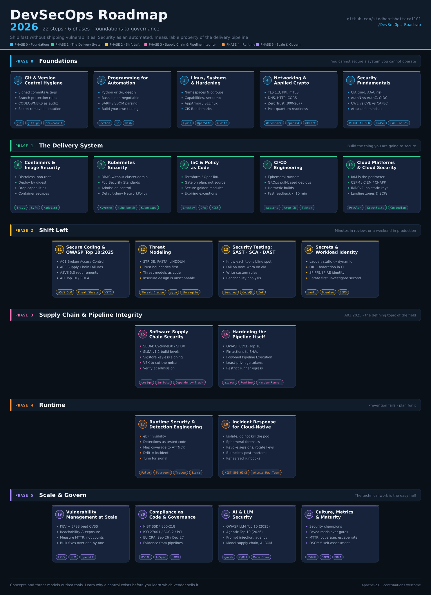
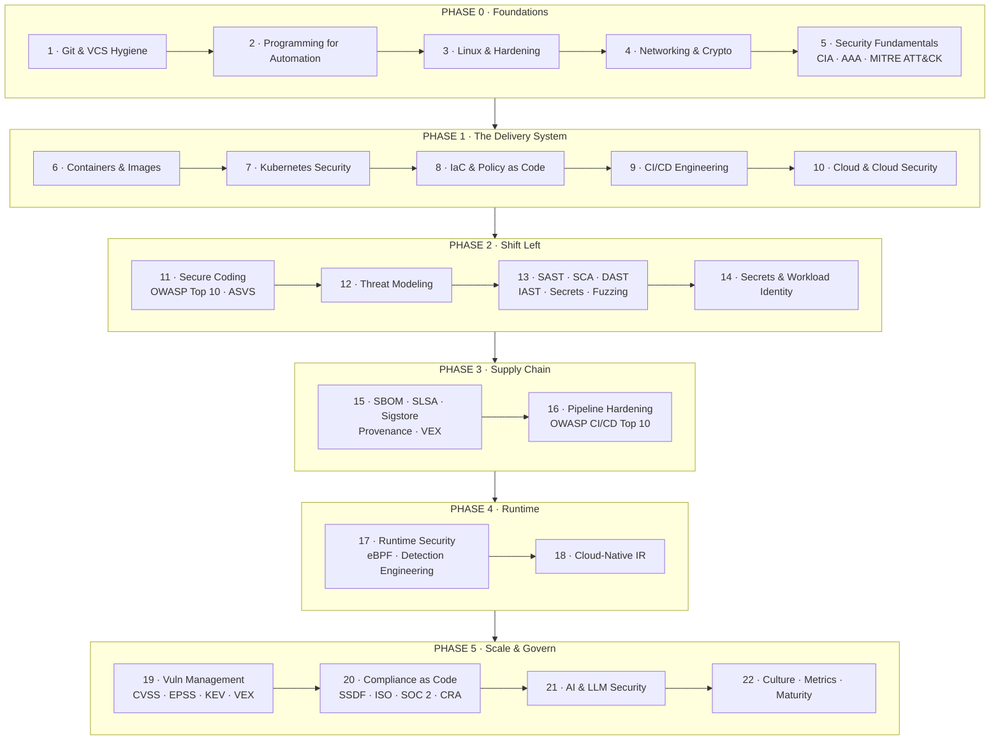
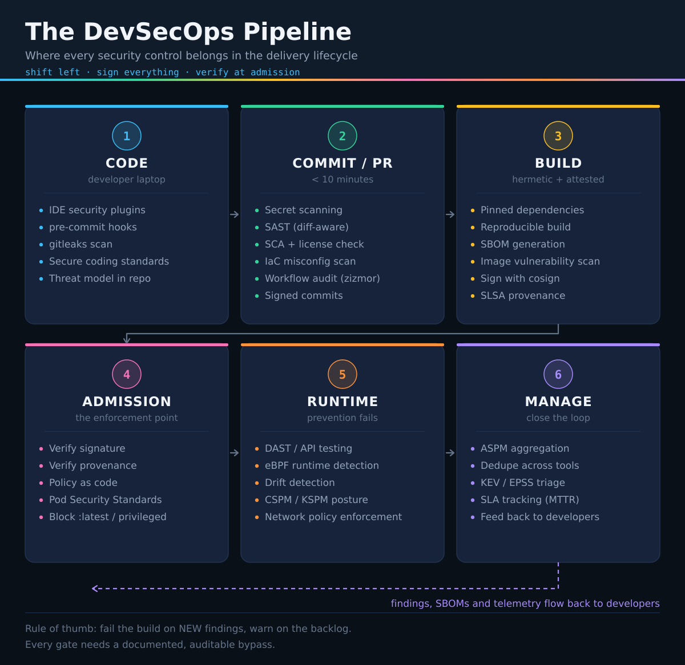
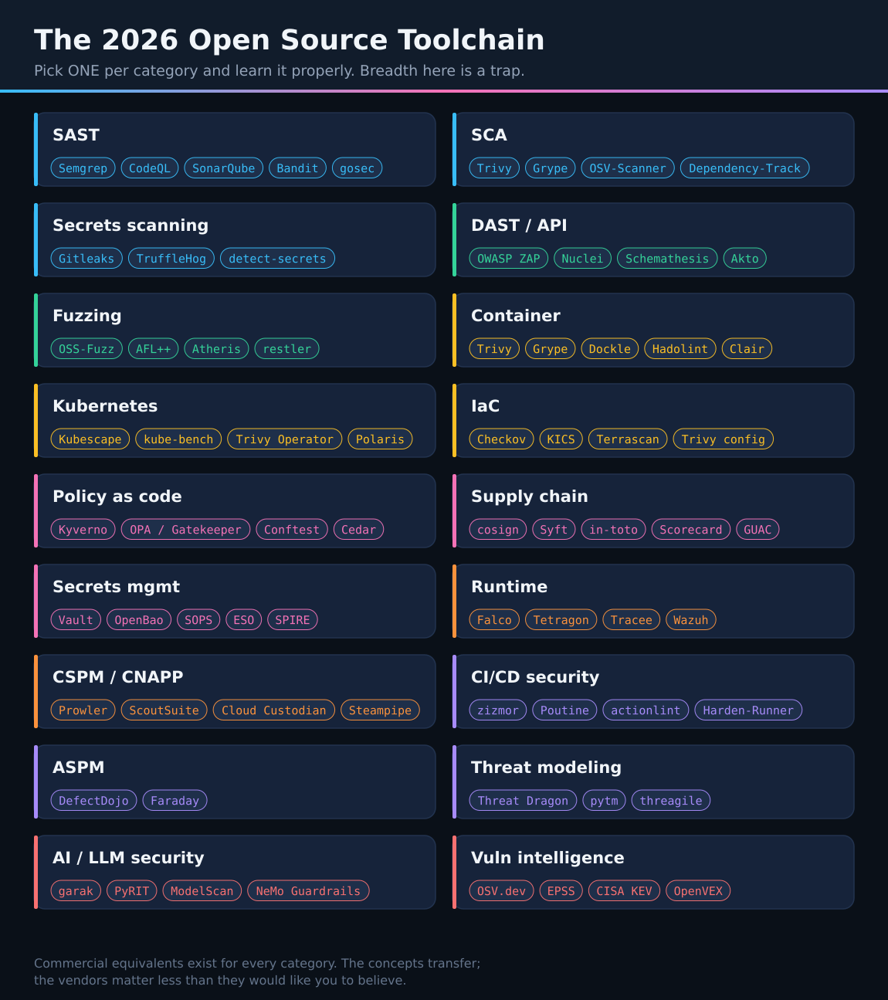

  
  

# DevSecOps Roadmap 2026

> A step-by-step guide to becoming a DevSecOps Engineer — with curated (mostly free) learning resources, the 2026 tool landscape, hands-on labs, checklists, and copy-pasteable pipeline examples.

DevOps roadmaps teach you how to **ship fast**. This one teaches you how to **ship fast without shipping vulnerabilities** — how to build a delivery system where security is an automated, measurable property of the pipeline rather than a gate at the end of it.

---

## The Roadmap

> This one is a dense poster — **click it to open full size**, where every step is readable. It is an SVG, so it stays sharp at any zoom.
> Also available as [PNG](assets/devsecops-roadmap.png) if you want to print it or drop it into slides.

---

## Start here

| I want to… | Go to |
|---|---|
| 📚 **Follow the roadmap** | [The 22 steps](#the-roadmap-at-a-glance) below |
| 🧪 **Get hands-on right now** | [Lab sheet](labs/lab-sheet.md) — trackable, with time and cost estimates |
| 🛠️ **Build something for my portfolio** | [13 portfolio projects](projects/README.md) |
| ✅ **Audit a system I own** | [Checklists](checklists/) |
| ⚙️ **Copy a working pipeline** | [Examples](examples/) |
| 🗓️ **Follow a structured plan** | [6-month](study-plans/6-month-plan.md) · [12-month](study-plans/12-month-plan.md) |
| 🧰 **Choose tools** | [Tool landscape](tools/README.md) |

---

## Give a Star ⭐

If this roadmap helps you, star the repo — it is the cheapest way to help others find it.

---

## Table of Contents

- [Who this is for](#who-this-is-for)
- [How to use this roadmap](#how-to-use-this-roadmap)
- [The roadmap at a glance](#the-roadmap-at-a-glance)
- [What changed in 2025–2026](#what-changed-in-20252026)
- **Phase 0 — Foundations**
  - [1. Git & Version Control Hygiene](#1-git--version-control-hygiene)
  - [2. A Programming Language for Automation](#2-a-programming-language-for-automation)
  - [3. Linux, Systems & Hardening](#3-linux-systems--hardening)
  - [4. Networking & Applied Cryptography](#4-networking--applied-cryptography)
  - [5. Security Fundamentals & the Attacker's Mindset](#5-security-fundamentals--the-attackers-mindset)
- **Phase 1 — The Delivery System**
  - [6. Containers & Image Security](#6-containers--image-security)
  - [7. Kubernetes & Orchestration Security](#7-kubernetes--orchestration-security)
  - [8. Infrastructure as Code & Policy as Code](#8-infrastructure-as-code--policy-as-code)
  - [9. CI/CD Engineering](#9-cicd-engineering)
  - [10. Cloud Platforms & Cloud Security](#10-cloud-platforms--cloud-security)
- **Phase 2 — Shift Left (AppSec)**
  - [11. Secure Coding & OWASP Top 10](#11-secure-coding--owasp-top-10)
  - [12. Threat Modeling](#12-threat-modeling)
  - [13. Security Testing: SAST, SCA, DAST, IAST & Fuzzing](#13-security-testing-sast-sca-dast-iast--fuzzing)
  - [14. Secrets Management & Workload Identity](#14-secrets-management--workload-identity)
- **Phase 3 — Supply Chain & Pipeline Integrity**
  - [15. Software Supply Chain Security](#15-software-supply-chain-security)
  - [16. Hardening the Pipeline Itself](#16-hardening-the-pipeline-itself)
- **Phase 4 — Runtime**
  - [17. Runtime Security & Detection Engineering](#17-runtime-security--detection-engineering)
  - [18. Incident Response for Cloud-Native](#18-incident-response-for-cloud-native)
- **Phase 5 — Scale & Govern**
  - [19. Vulnerability Management at Scale](#19-vulnerability-management-at-scale)
  - [20. Compliance as Code & Governance](#20-compliance-as-code--governance)
  - [21. AI & LLM Security](#21-ai--llm-security)
  - [22. Culture, Metrics & Maturity](#22-culture-metrics--maturity)
- [Reference pipeline architecture](#reference-pipeline-architecture)
- [The 2026 tool landscape](#the-2026-tool-landscape)
- [Certifications](#certifications)
- [Hands-on labs & practice](#hands-on-labs--practice) → [lab sheet](labs/lab-sheet.md)
- [Portfolio projects](projects/README.md)
- [Books](#books)
- [Newsletters, podcasts & channels](#newsletters-podcasts--channels)
- [Study plans](#study-plans)
- [Repo contents](#repo-contents)
- [Contributing](#contributing)
- [License](#license)

---

## Who this is for

| You are… | Start at |
|---|---|
| A **developer** who wants to own security | Phase 2 → Phase 3 → back-fill Phase 1 |
| A **DevOps / platform / SRE** engineer | Phase 2 (you already have Phase 0–1) |
| A **security analyst / SOC** moving to product security | Phase 0 (skip 4–5) → Phase 1 → Phase 3 |
| A **student or career switcher** | Phase 0, in order, no skipping |
| An **engineering manager** | Read Phases 3 and 5, plus [Culture, Metrics & Maturity](#22-culture-metrics--maturity) |

### Disclaimer

> This roadmap describes the *landscape*, not a mandatory checklist. Nobody is expert in all 22 areas — senior DevSecOps engineers are typically deep in 3–5 of them and conversant in the rest. Tools change; **concepts, threat models, and trade-offs do not**. Learn why a control exists before you learn which vendor sells it.

---

## How to use this roadmap

1. **Do not read it front to back.** Pick your entry point from the table above.
2. **Every step ends in an artifact.** Each section has a "Prove it" line — a small deliverable. A roadmap you only read is entertainment; a roadmap you build against is a portfolio.
3. **Pair each concept with an attack.** Do not learn "sign your artifacts" — learn the SolarWinds and `tj-actions` attacks first, then the control makes sense on its own.
4. **Build one paved road, not twelve integrations.** The DevSecOps job is not "run every scanner." It is "make the secure path the easiest path."

Legend: FREE free · PAID costs money · OSS open source tool · BOOK book

---

## The roadmap at a glance

The same 22 steps as the poster above, as a flow you can navigate — every box links to its section.

**Roughly how long each phase takes**, at ~10 focused hours a week, assuming you are starting that phase cold:

| Phase | Cold start | With a DevOps background |
|---|---|---|
| 0 · Foundations | 10–14 weeks | 2–3 weeks (revision) |
| 1 · Delivery System | 10–12 weeks | 4–6 weeks |
| 2 · Shift Left | 8–10 weeks | 8–10 weeks |
| 3 · Supply Chain | 4–6 weeks | 4–6 weeks |
| 4 · Runtime | 4–6 weeks | 4–6 weeks |
| 5 · Scale & Govern | 6–8 weeks | 6–8 weeks |

Phases 2 and onwards take the same time regardless of background — that is the part that is genuinely new to everyone.

---

## What changed in 2025–2026

If you are reading a roadmap written before 2024, these are the things it is missing. They are not footnotes — several of them are now the *centre* of the job.

| Change | Why it matters |
|---|---|
| **OWASP Top 10:2025** shipped | *Software Supply Chain Failures* jumped to **A03** (up from "Vulnerable and Outdated Components"), *Security Misconfiguration* moved to **A02**, SSRF folded into *Broken Access Control*, and *Mishandling of Exceptional Conditions* is brand new at **A10**. ([Top 10:2025](https://owasp.org/Top10/2025/)) |
| **OWASP ASVS 5.0** (May 2025) | First major rewrite since 2019 — ~350 requirements across 17 chapters, restructured for cloud-native, API-first and DevOps workflows. ([asvs.dev](https://asvs.dev/)) |
| **EU Cyber Resilience Act** is now a clock, not a proposal | In force since **10 Dec 2024**. **11 Sep 2026**: 24-hour reporting of actively exploited vulnerabilities to ENISA. **11 Dec 2027**: full obligations — secure-by-design, CE marking, **SBOMs**, vulnerability handling. Fines up to €15M or 2.5% of global turnover. |
| **Supply chain attacks became routine — and self-replicating** | `tj-actions/changed-files` ([CVE-2025-30066](https://github.com/advisories/GHSA-mrrh-fwg8-r2c3)) compromised ~23,000 repos in March 2025 by rewriting *existing version tags*; only SHA-pinned consumers were safe. Then the **`Shai-Hulud`** npm worm (Sept & Nov 2025) used stolen maintainer tokens to republish packages automatically — a supply chain attack that spread with no attacker in the loop. |
| **SBOMs outgrew software** | CycloneDX now covers CBOM (cryptography), SaaSBOM, and **AI/ML-BOM** — you will be asked to inventory your crypto for post-quantum migration and your models for AI governance, not just your libraries. |
| **SLSA v1.2** is the current spec | Build track L0–L3 plus newer tracks; provenance and attestations are table stakes, not aspiration. ([slsa.dev](https://slsa.dev/spec/)) |
| **Supply chain frameworks graduated** | **in-toto** graduated in the CNCF (Apr 2025); **Kyverno** graduated (Mar 2026); **Falco** graduated (2024). Policy-as-code and runtime security are now mature, boring infrastructure. |
| **Vulnerability triage moved past CVSS** | KEV + EPSS + reachability + exposure beat raw CVSS. CISA's **BOD 26-04** (Jun 2026) formalised risk-based prioritisation for US federal agencies. A CVSS 9.8 on an unreachable path loses to a CVSS 6.5 that is internet-facing and in KEV. |
| **AI security became a real discipline** | **OWASP Top 10 for LLM Applications (2025)** and **OWASP Top 10 for Agentic Applications (2026)** now cover prompt injection, system prompt leakage, vector/embedding weaknesses, agent goal hijacking, tool misuse, and memory poisoning. AI coding assistants and MCP servers are new supply chain surfaces. |
| **ASPM consolidated the tool sprawl** | Application Security Posture Management replaced "twelve scanners, twelve dashboards" with correlation, deduplication, and one risk view. |

---

# Phase 0 — Foundations

You cannot secure a system you cannot operate. Phase 0 is the same ground a DevOps engineer covers, viewed through a security lens.

## 1. Git & Version Control Hygiene

Everything downstream — application code, infrastructure, policies, pipeline definitions — lives in Git. That makes your VCS the single highest-value target in the organisation, and also the single best enforcement point.

**Learn:**
- Core mechanics: clone, branch, merge, rebase, cherry-pick, bisect, reflog, and what a commit object actually *is*
- Branching strategies (trunk-based vs GitFlow) and why trunk-based suits continuous delivery
- **Signed commits and tags** — GPG, SSH signing, and [Gitsign](https://github.com/sigstore/gitsign) (keyless, via Sigstore)
- **Branch protection / rulesets**: required reviews, required status checks, linear history, no force-push to default
- `CODEOWNERS` as an authorization control, not a convenience
- Removing secrets from history properly ([git-filter-repo](https://github.com/newren/git-filter-repo), BFG) — and why **rotation beats rewriting** every time
- `.gitignore` / `.gitattributes` discipline, and pre-commit hooks as the first line of defence

**Prove it:** a repo with signed commits, enforced rulesets, CODEOWNERS, and a `pre-commit` config that blocks secrets.

**Resources:**
- [Pro Git Book](https://git-scm.com/book/en/v2) FREE BOOK
- [Learn Git Branching](https://learngitbranching.js.org/) — interactive FREE
- [GitHub: About protected branches & rulesets](https://docs.github.com/en/repositories/configuring-branches-and-merges-in-your-repository/managing-rulesets) FREE
- [Sigstore Gitsign](https://github.com/sigstore/gitsign) FREE
- [git-filter-repo](https://github.com/newren/git-filter-repo) OSS
- [OWASP: Source Code Management security](https://cheatsheetseries.owasp.org/cheatsheets/Secrets_Management_Cheat_Sheet.html) FREE

---

## 2. A Programming Language for Automation

DevSecOps is a *software engineering* role. If you cannot write code, you will spend your career clicking through vendor dashboards and filing tickets.

**Pick one and go deep:**

| Language | Best for | Why |
|---|---|---|
| **Python** | Automation, tooling, glue, security research | Largest security ecosystem; nearly every security API has a Python SDK |
| **Go** | Cloud-native tooling, Kubernetes controllers, CLIs | The language most of your tools (Trivy, Falco parts, Kyverno, cosign, Terraform) are written in — reading their source is a superpower |
| **Bash** | Non-negotiable | You will read and write it whether you like it or not |
| **Rust** | Performance-sensitive and memory-safe tooling | Increasingly common in new security tooling; memory safety is itself a security property |

**Also learn to read:** JavaScript/TypeScript, Java, and C# — you will review code in languages you do not write. **YAML and JSON schema** matter more than you expect: most of your "code" will be declarative.

**Security-specific skills:** API clients with retries and rate limiting, parsing SARIF, working with SBOM formats (CycloneDX / SPDX), writing a scanner wrapper that normalizes findings, and building small CLI tools your team will actually use.

**Prove it:** a CLI that pulls findings from two scanners, normalizes them to SARIF, and deduplicates.

**Resources:**
- [Automate the Boring Stuff with Python](https://automatetheboringstuff.com/) FREE BOOK
- [Black Hat Python, 2nd Ed.](https://nostarch.com/black-hat-python2E) PAID BOOK
- [Go by Example](https://gobyexample.com/) FREE
- [Learn Go with Tests](https://quii.gitbook.io/learn-go-with-tests) FREE
- [SARIF specification](https://docs.oasis-open.org/sarif/sarif/v2.1.0/sarif-v2.1.0.html) — the interchange format for static analysis results FREE
- [Google Shell Style Guide](https://google.github.io/styleguide/shellguide.html) FREE
- [ShellCheck](https://www.shellcheck.net/) OSS

---

## 3. Linux, Systems & Hardening

Your workloads run on Linux. Containers *are* Linux — namespaces, cgroups, capabilities, and seccomp. If those five words are unfamiliar, container security will never be more than magic incantations to you.

**Learn:**
- Filesystem layout, permissions, ownership, `setuid`/`setgid`, sticky bits, ACLs
- Users, groups, PAM, `sudoers` — and why `sudo ALL=(ALL) NOPASSWD:ALL` is a finding
- Processes, signals, systemd units and their sandboxing directives (`ProtectSystem`, `PrivateTmp`, `NoNewPrivileges`)
- **The container primitives**: namespaces (pid, net, mnt, uts, ipc, user, cgroup), cgroups v2, **Linux capabilities**, seccomp-bpf, AppArmor / SELinux
- Logging: journald, syslog, auditd rules, log shipping
- Package management and patching; unattended upgrades; **immutable / minimal base images** as an alternative to patching
- Hardening baselines: **CIS Benchmarks**, DISA STIGs, and automating them with OpenSCAP / Ansible
- SSH hardening: key-only auth, certificate authorities, bastion patterns, no agent-forwarding into untrusted hosts

**Prove it:** take a stock Ubuntu image to a CIS Level 1 benchmark pass using Ansible, with an OpenSCAP report as evidence.

**Resources:**
- [The Linux Command Handbook](https://www.freecodecamp.org/news/the-linux-commands-handbook/) FREE
- [Linux Journey](https://linuxjourney.com/) FREE
- [OverTheWire: Bandit](https://overthewire.org/wargames/bandit/) — Linux via CTF FREE
- [How Linux Works, 3rd Ed.](https://nostarch.com/howlinuxworks3) PAID BOOK
- [Linux Basics for Hackers](https://nostarch.com/linuxbasicsforhackers) PAID BOOK
- [CIS Benchmarks](https://www.cisecurity.org/cis-benchmarks) FREE
- [OpenSCAP](https://www.open-scap.org/) OSS
- [Lynis](https://github.com/CISOfy/lynis) — host auditing OSS
- [seccomp overview (man7)](https://man7.org/linux/man-pages/man2/seccomp.2.html) and [capabilities(7)](https://man7.org/linux/man-pages/man7/capabilities.7.html) FREE

---

## 4. Networking & Applied Cryptography

Most cloud breaches reduce to two questions: *what could reach it,* and *what did it trust.* Both are networking questions.

**Networking:**
- OSI/TCP-IP models, TCP vs UDP, the three-way handshake, MTU, NAT
- IP addressing, CIDR, subnetting, routing — you will design VPCs
- DNS end-to-end, plus **DNSSEC**, DNS exfiltration, and DNS rebinding
- HTTP/1.1, HTTP/2, HTTP/3 and QUIC; headers; cookies; CORS; the same-origin policy
- Load balancers, reverse proxies, CDNs, WAFs, API gateways
- **Zero Trust architecture** ([NIST SP 800-207](https://csrc.nist.gov/pubs/sp/800/207/final)) — identity as the perimeter
- Network segmentation, microsegmentation, egress filtering (the control most orgs skip and most attackers need)

**Cryptography — applied, not academic:**
- Symmetric (AES-GCM, ChaCha20-Poly1305) vs asymmetric (RSA, ECDSA, Ed25519)
- Hashing (SHA-2/SHA-3) vs password hashing (**Argon2id**, scrypt, bcrypt) — and why the difference matters
- HMAC, digital signatures, and what a signature actually proves
- **TLS 1.3**: handshake, cipher suites, certificate chains, OCSP/CRL, mTLS, certificate pinning
- PKI: CAs, intermediate CAs, CSRs, ACME/Let's Encrypt, private CAs, certificate lifecycle and rotation
- Key management: envelope encryption, KMS/HSM, key rotation, **never roll your own crypto**
- **Post-quantum cryptography**: ML-KEM / ML-DSA (FIPS 203/204), hybrid key exchange, and "harvest now, decrypt later" — start inventorying your crypto now

**Prove it:** a Wireshark capture of a TLS 1.3 handshake, annotated, plus a working private CA issuing mTLS certs between two services.

**Resources:**
- [Computer Networking: A Top-Down Approach — companion videos](https://www.youtube.com/playlist?list=PLByK_3hwzY3Tysh-SY9MKZhMm9wIfNOas) FREE
- [Professor Messer Network+](https://www.professormesser.com/network-plus/n10-009/n10-009-video/n10-009-training-course/) FREE
- [How DNS works](https://howdns.works/) · [How HTTPS works](https://howhttps.works/) · [How DNSSEC works](https://howdnssec.works/) FREE
- [High Performance Browser Networking](https://hpbn.co/) — Ilya Grigorik FREE BOOK
- [Crypto 101](https://www.crypto101.io/) FREE BOOK
- [Cryptopals Crypto Challenges](https://cryptopals.com/) — learn crypto by breaking it FREE
- [Serious Cryptography, 2nd Ed.](https://nostarch.com/serious-cryptography-2nd-edition) — Jean-Philippe Aumasson PAID BOOK
- [NIST SP 800-207: Zero Trust Architecture](https://csrc.nist.gov/pubs/sp/800/207/final) FREE
- [NIST Post-Quantum Cryptography project](https://csrc.nist.gov/projects/post-quantum-cryptography) FREE
- [Mozilla TLS Configuration Generator](https://ssl-config.mozilla.org/) FREE
- [SSL Labs Server Test](https://www.ssllabs.com/ssltest/) FREE

---

## 5. Security Fundamentals & the Attacker's Mindset

You cannot defend what you cannot attack. This section is what separates "a DevOps engineer who runs scanners" from a DevSecOps engineer.

**Core concepts:**
- **CIA triad** (confidentiality, integrity, availability) and where each fails in practice
- **AAA**: authentication, authorization, accounting; AuthN vs AuthZ; OAuth 2.0/2.1, OIDC, SAML, JWT (and JWT's many footguns)
- Least privilege, separation of duties, defence in depth, fail-secure, **secure by default**
- Risk = likelihood × impact; risk acceptance, transfer, mitigation; residual risk
- **Vulnerability vs exploit vs threat vs risk** — used loosely by almost everyone, and precision here makes you credible

**The attacker's view:**
- **MITRE ATT&CK** — the shared vocabulary for adversary behaviour ([attack.mitre.org](https://attack.mitre.org/)), including the [Cloud](https://attack.mitre.org/matrices/enterprise/cloud/) and [Containers](https://attack.mitre.org/matrices/enterprise/containers/) matrices
- **CWE** (weakness classes) vs **CVE** (specific instances) vs **CAPEC** (attack patterns) — and the [CWE Top 25](https://cwe.mitre.org/top25/)
- The Cyber Kill Chain and the Pyramid of Pain
- Reading a real exploit chain end to end: initial access → execution → persistence → privilege escalation → lateral movement → exfiltration
- Post-mortems as curriculum: SolarWinds, Log4Shell, Codecov, Okta, MOVEit, `xz-utils`/CVE-2024-3094, `tj-actions`

**Prove it:** map one real breach to ATT&CK techniques and list the three cheapest controls that would have broken the chain.

**Resources:**
- [MITRE ATT&CK](https://attack.mitre.org/) FREE
- [MITRE ATT&CK Training (MAD)](https://attack.mitre.org/resources/learn-more-about-attack/training/) FREE
- [PortSwigger Web Security Academy](https://portswigger.net/web-security) — the single best free AppSec training that exists FREE
- [OWASP Cheat Sheet Series](https://cheatsheetseries.owasp.org/) FREE
- [NIST CSF 2.0](https://www.nist.gov/cyberframework) FREE
- [CWE Top 25](https://cwe.mitre.org/top25/) FREE
- [Professor Messer Security+ SY0-701](https://www.professormesser.com/security-plus/sy0-701/sy0-701-video/sy0-701-comptia-security-plus-course/) FREE
- [Google/Coursera Cybersecurity Certificate](https://www.coursera.org/professional-certificates/google-cybersecurity) PAID

---

# Phase 1 — The Delivery System

Now build the thing you are going to secure. Each topic here is covered *with* its security dimension rather than after it.

## 6. Containers & Image Security

A container is a process with restricted views of the kernel. Everything about container security follows from that sentence.

**Learn:**
- Images, layers, the OCI image spec, registries, tags vs **digests** (always deploy by digest)
- Dockerfile craft: multi-stage builds, non-root `USER`, minimal base images, `COPY` over `ADD`, `.dockerignore`, no secrets in layers (they persist even if deleted in a later layer)
- **Distroless / Chainguard / Wolfi / Alpine** — reducing the attack surface by removing the shell and package manager entirely
- Runtime hardening: drop all capabilities and add back only what is needed, read-only root filesystem, `no-new-privileges`, seccomp and AppArmor profiles, **never `--privileged`**
- User namespaces and rootless containers (Podman, rootless Docker)
- Container escapes: privileged containers, mounted Docker socket, `hostPID`/`hostNetwork`, writable `/proc`, `CAP_SYS_ADMIN`, [runC CVE-2024-21626](https://github.com/opencontainers/runc/security/advisories/GHSA-xr7r-f8xq-vfvv)
- **Image scanning and signing**: Trivy/Grype for vulnerabilities, Syft for SBOMs, cosign for signatures
- Registry security: private registries, immutable tags, pull-through caches, image expiry policies, Harbor with signature enforcement

**Tools:** [Trivy](https://github.com/aquasecurity/trivy) · [Grype](https://github.com/anchore/grype) · [Syft](https://github.com/anchore/syft) · [Hadolint](https://github.com/hadolint/hadolint) · [Dockle](https://github.com/goodwithtech/dockle) · [Docker Bench](https://github.com/docker/docker-bench-security) · [Cosign](https://github.com/sigstore/cosign) · [Harbor](https://goharbor.io/) · [Chainguard Images](https://images.chainguard.dev/) · [Distroless](https://github.com/GoogleContainerTools/distroless) · [Podman](https://podman.io/)

**Prove it:** take a naïve `node:latest` Dockerfile to a distroless, non-root, SBOM-attested, cosign-signed image and show the CVE count before and after.

**Start from:** [`examples/docker/`](examples/docker/) — both halves of that exercise, with each change annotated by what it actually removes.

**Resources:**
- [Docker Docs: Build best practices](https://docs.docker.com/build/building/best-practices/) FREE
- [OWASP Docker Security Cheat Sheet](https://cheatsheetseries.owasp.org/cheatsheets/Docker_Security_Cheat_Sheet.html) FREE
- [Container Security](https://www.oreilly.com/library/view/container-security/9781492056690/) — Liz Rice PAID BOOK *(the best book on this topic)*
- [Learning Containers From The Bottom Up](https://iximiuz.com/en/posts/container-learning-path/) FREE
- [CIS Docker Benchmark](https://www.cisecurity.org/benchmark/docker) FREE
- [NIST SP 800-190: Application Container Security Guide](https://csrc.nist.gov/pubs/sp/800/190/final) FREE

---

## 7. Kubernetes & Orchestration Security

Kubernetes is a distributed system with an API that can, by default, be persuaded to run anything anywhere. It is also where most cloud-native security work happens.

**Learn:**

**Cluster & control plane**
- Architecture: API server, etcd, scheduler, controller-manager, kubelet, CNI/CSI
- **Encrypt etcd at rest**; restrict etcd access; it holds every Secret you have
- API server hardening, audit logging (and actually shipping those logs somewhere)
- Node hardening; kubelet authn/authz; disabling the read-only port

**Identity & access**
- **RBAC** done properly: Roles vs ClusterRoles, avoiding `cluster-admin`, why `escalate`/`bind`/`impersonate` verbs are privilege escalation
- ServiceAccounts, bound projected tokens, and **workload identity federation** to cloud IAM
- `kubectl auth can-i --list`, and tools like [rbac-tool](https://github.com/alcideio/rbac-tool) and [KubiScan](https://github.com/cyberark/KubiScan)

**Workload security**
- **Pod Security Standards** (privileged / baseline / restricted) and Pod Security Admission — the replacement for PodSecurityPolicy
- securityContext: `runAsNonRoot`, `readOnlyRootFilesystem`, `allowPrivilegeEscalation: false`, dropped capabilities, seccomp `RuntimeDefault`
- Resource limits as a denial-of-service control

**Policy as code (admission control)**
- **Kyverno** (CNCF Graduated, Mar 2026) — YAML-native policies, mutation, generation, image verification
- **OPA / Gatekeeper** — Rego, constraint templates
- Kubernetes-native **ValidatingAdmissionPolicy** (CEL) — no external webhook required
- Policy for *supply chain*: verify cosign signatures at admission, block unsigned images

**Network**
- **NetworkPolicy** — default-deny ingress *and egress*, then allow explicitly
- **Cilium** (eBPF CNI, CNCF Graduated) — L3–L7 policy, Hubble observability
- Service mesh mTLS: Istio, Linkerd — and whether you actually need one
- Ingress controllers and their historically excellent CVE record (in the bad sense)

**Secrets**
- Kubernetes Secrets are **base64, not encrypted** — pair with KMS encryption at rest, or externalize entirely
- **External Secrets Operator**, Vault Agent Injector / CSI driver, Sealed Secrets, SOPS

**Assurance**
- CIS Kubernetes Benchmark via [kube-bench](https://github.com/aquasecurity/kube-bench)
- [Kubescape](https://github.com/kubescape/kubescape) (CNCF) — posture scanning against NSA/CISA and CIS frameworks
- [Trivy Operator](https://github.com/aquasecurity/trivy-operator) — continuous in-cluster scanning
- [kube-hunter](https://github.com/aquasecurity/kube-hunter), [Kubernetes Goat](https://madhuakula.com/kubernetes-goat/) for offensive practice

**Prove it:** a cluster that fails to deploy a privileged, unsigned, `:latest`-tagged pod — for three independent reasons, each from a different control.

**Resources:**
- [Kubernetes Security documentation](https://kubernetes.io/docs/concepts/security/) FREE
- [NSA/CISA Kubernetes Hardening Guide](https://media.defense.gov/2022/Aug/29/2003066362/-1/-1/0/CTR_KUBERNETES_HARDENING_GUIDANCE_1.2_20220829.PDF) FREE
- [OWASP Kubernetes Top 10](https://owasp.org/www-project-kubernetes-top-ten/) FREE
- [Kubernetes Goat](https://madhuakula.com/kubernetes-goat/) — deliberately vulnerable cluster FREE
- [Hacking Kubernetes](https://www.oreilly.com/library/view/hacking-kubernetes/9781492081722/) — Rice & Hausenblas PAID BOOK
- [Kyverno policy library](https://kyverno.io/policies/) FREE
- [OPA Gatekeeper library](https://open-policy-agent.github.io/gatekeeper-library/website/) FREE
- [Certified Kubernetes Security Specialist (CKS)](https://www.cncf.io/training/certification/cks/) PAID

---

## 8. Infrastructure as Code & Policy as Code

Misconfiguration is now **A02 in the OWASP Top 10:2025**. IaC is where misconfiguration is either mass-produced or mass-prevented.

**IaC:**
- **Terraform / OpenTofu** — providers, state, modules, workspaces; **remote state is a secrets store, treat it like one** (encrypted, locked, access-controlled)
- Ansible for configuration management; Ansible Vault
- Pulumi (IaC in real languages), CloudFormation, Bicep, Crossplane
- Drift detection and why manual console changes are a security incident in slow motion
- Module registries and pinning — IaC has a supply chain too

**Policy as code:**
- **Open Policy Agent / Rego** — the general-purpose policy engine; `conftest` for testing configs
- **Checkov** (Bridgecrew/Prisma) — broadest IaC rule coverage, supports Terraform, CFN, K8s, ARM, Helm, and more
- **Trivy config** / tfsec — fast Terraform misconfiguration scanning
- **KICS** (Checkmarx), **Terrascan**, **Terraform Sentinel** PAID, **Pulumi CrossGuard**
- **Cedar** (AWS) — authorization policy language
- Writing custom policies: a policy nobody wrote for your organisation's actual rules is a policy you do not have

**Patterns that matter:**
- Gate on **plan**, not just source — scan the Terraform plan JSON so you evaluate the real resulting state
- Secure-by-default **golden modules**: the S3 module that cannot produce a public bucket
- Exceptions with expiry dates, tracked in code

**Prove it:** a Terraform module + Checkov/OPA gate where the insecure configuration cannot merge, and the exception path requires an expiring, reviewed waiver.

**Resources:**
- [Terraform documentation](https://developer.hashicorp.com/terraform/docs) · [OpenTofu](https://opentofu.org/docs/) FREE
- [OPA documentation](https://www.openpolicyagent.org/docs/latest/) and [The Rego Playground](https://play.openpolicyagent.org/) FREE
- [Checkov](https://www.checkov.io/) OSS
- [KICS](https://kics.io/) OSS
- [Conftest](https://www.conftest.dev/) OSS
- [TerraGoat — vulnerable Terraform](https://github.com/bridgecrewio/terragoat) FREE
- [Terraform: Up & Running, 3rd Ed.](https://www.terraformupandrunning.com/) — Yevgeniy Brikman PAID BOOK

---

## 9. CI/CD Engineering

Before you can secure a pipeline you must be able to build a good one. Note the distinction: **this section is about building pipelines; [section 16](#16-hardening-the-pipeline-itself) is about defending them.**

**Learn:**
- Pipeline anatomy: source → build → test → package → scan → sign → deploy → verify
- **GitHub Actions** (workflows, jobs, reusable workflows, environments, OIDC), **GitLab CI**, Jenkins, Argo Workflows, Tekton, CircleCI, Azure DevOps
- **GitOps**: Argo CD, Flux — declarative deploys with the cluster pulling from Git, which is also a security property (no cluster credentials in CI)
- Deployment strategies: blue/green, canary, progressive delivery, feature flags — and their rollback story
- Artifact repositories: container registries, Artifactory, Nexus, GitHub Packages
- **Build reproducibility and hermetic builds** — a prerequisite for meaningful provenance
- Ephemeral, single-use runners; why self-hosted runners on public repos are a well-documented disaster
- Caching correctly (cache poisoning is a real attack class)

**Where security fits — the golden rules:**
1. **Fast feedback beats complete feedback.** A 40-minute scan gets disabled. Run incremental/diff-aware scans on PRs and full scans nightly.
2. **Fail on *new* findings, warn on the backlog.** Otherwise your first rollout blocks every build in the company and gets reverted by lunchtime.
3. **Every gate needs a documented, auditable bypass** — or engineers will invent an undocumented one.

**Prove it:** a pipeline that runs SAST, SCA, secret scanning, IaC scanning, and container scanning in under 10 minutes on a PR, uploading SARIF to code scanning.

**Resources:**
- [GitHub Actions documentation](https://docs.github.com/en/actions) FREE
- [GitLab CI/CD documentation](https://docs.gitlab.com/ee/ci/) FREE
- [Argo CD](https://argo-cd.readthedocs.io/) · [Flux](https://fluxcd.io/) FREE
- [Continuous Delivery](https://www.oreilly.com/library/view/continuous-delivery-reliable/9780321670250/) — Humble & Farley PAID BOOK
- [DORA / State of DevOps reports](https://dora.dev/research/) FREE
- [Reproducible Builds](https://reproducible-builds.org/) FREE

---

## 10. Cloud Platforms & Cloud Security

**Go deep on one cloud, be conversant in the rest.** The concepts transfer; the failure modes are cloud-specific.

**Per cloud, learn:**
- **Identity** (the actual perimeter): AWS IAM roles/policies/SCPs/permission boundaries; Azure Entra ID + RBAC; GCP IAM + org policies
- Compute (EC2/VM/GCE), containers (EKS/AKS/GKE), serverless (Lambda/Functions), storage, networking (VPC, security groups, NACLs, private endpoints)
- Encryption: KMS, envelope encryption, customer-managed keys, encryption in transit
- Logging: CloudTrail / Azure Activity + Diagnostic logs / GCP Cloud Audit Logs — and **retaining them somewhere the attacker cannot delete**
- Organizations, landing zones, guardrails: AWS Control Tower + SCPs, Azure Policy, GCP Organization Policy

**Cloud security disciplines — know the acronyms, they are how the market talks:**

| Acronym | Full name | What it does |
|---|---|---|
| **CSPM** | Cloud Security Posture Management | Finds misconfigurations across cloud accounts |
| **CWPP** | Cloud Workload Protection Platform | Protects VMs/containers/serverless at runtime |
| **CIEM** | Cloud Infrastructure Entitlement Management | Finds excessive/unused permissions |
| **KSPM** | Kubernetes Security Posture Management | CSPM, but for clusters |
| **CNAPP** | Cloud-Native Application Protection Platform | The consolidated bundle of the above |
| **ASPM** | Application Security Posture Management | Correlates AppSec findings across tools into one risk view |
| **DSPM** | Data Security Posture Management | Finds and classifies sensitive data across cloud stores |

**Recurring failure patterns:** public storage buckets · over-permissive IAM (`*:*`) · long-lived access keys in CI · unencrypted snapshots shared publicly · **the SSRF → instance metadata (IMDSv1) → credential theft chain** (enforce IMDSv2) · unmonitored `AssumeRole` chains · abandoned dev accounts with production network access.

**Tools:** [Prowler](https://github.com/prowler-cloud/prowler) OSS · [ScoutSuite](https://github.com/nccgroup/ScoutSuite) OSS · [CloudQuery](https://www.cloudquery.io/) · [Steampipe/Powerpipe](https://steampipe.io/) OSS · [Cloud Custodian](https://cloudcustodian.io/) OSS · [Pacu](https://github.com/RhinoSecurityLabs/pacu) (AWS exploitation) OSS · [PMapper](https://github.com/nccgroup/PMapper) · AWS Security Hub / GuardDuty / IAM Access Analyzer · Microsoft Defender for Cloud · Google Security Command Center

**Prove it:** run Prowler against a real (personal) account, fix the top 10 findings, and codify the fixes as SCPs/Org Policies so they cannot recur.

**Resources:**
- [AWS Well-Architected — Security Pillar](https://docs.aws.amazon.com/wellarchitected/latest/security-pillar/welcome.html) FREE
- [Google Cloud Architecture Framework — Security](https://cloud.google.com/architecture/framework/security) FREE
- [Microsoft Cloud Adoption Framework — Security](https://learn.microsoft.com/en-us/azure/cloud-adoption-framework/secure/) FREE
- [CloudGoat](https://github.com/RhinoSecurityLabs/cloudgoat) — vulnerable-by-design AWS FREE
- [flaws.cloud](http://flaws.cloud/) and [flaws2.cloud](http://flaws2.cloud/) FREE
- [IAM Vulnerable](https://github.com/BishopFox/iam-vulnerable) FREE
- [Hacking the Cloud](https://hackingthe.cloud/) FREE
- [CIS Benchmarks for AWS/Azure/GCP](https://www.cisecurity.org/cis-benchmarks) FREE

---

# Phase 2 — Shift Left

Finding a flaw in review costs minutes. Finding it in production costs a weekend and a customer email.

## 11. Secure Coding & OWASP Top 10

**The OWASP Top 10:2025** is the baseline vocabulary. Learn it, then move to ASVS for depth.

| # | Category (2025) | Change from 2021 |
|---|---|---|
| A01 | **Broken Access Control** | Still #1; SSRF folded in |
| A02 | **Security Misconfiguration** | ▲ up from #5 |
| A03 | **Software Supply Chain Failures** | ▲ expanded from "Vulnerable & Outdated Components" |
| A04 | **Cryptographic Failures** | ▼ down from #2 |
| A05 | **Injection** | ▼ down from #3 |
| A06 | **Insecure Design** | — |
| A07 | **Authentication Failures** | — |
| A08 | **Software or Data Integrity Failures** | — |
| A09 | **Security Logging and Alerting Failures** | renamed |
| A10 | **Mishandling of Exceptional Conditions** | 🆕 **new** — fail-open, error handling, logic errors |

**Beyond the Top 10:**
- **OWASP ASVS 5.0** — ~350 testable requirements across 17 chapters at three verification levels. This is what you write acceptance criteria from.
- **OWASP API Security Top 10** — BOLA/BFLA are the API-specific access control failures and dominate real-world API breaches
- **OWASP Mobile Top 10** and **MASVS** if you ship mobile
- **OWASP Proactive Controls** — the positive framing: what to *do*, not what to avoid

**Practices:**
- Input validation (allow-list), output encoding, parameterized queries, ORMs used correctly
- AuthN/AuthZ patterns: enforce authorization at the object level, server-side, every time
- Session management, CSRF, secure cookie flags, CSP and the other security headers
- Dependency hygiene and the difference between "a CVE exists" and "you call the vulnerable function"
- **Secure code review** — see [`checklists/secure-code-review.md`](checklists/secure-code-review.md)
- Security unit tests: every fixed vulnerability gets a regression test

**Prove it:** complete all of PortSwigger's access control and SSRF labs, then write ASVS-derived acceptance criteria for one of your own services.

**Resources:**
- [OWASP Top 10:2025](https://owasp.org/Top10/2025/) FREE
- [OWASP ASVS 5.0](https://asvs.dev/) FREE
- [OWASP API Security Top 10](https://owasp.org/API-Security/editions/2023/en/0x00-header/) FREE
- [OWASP Cheat Sheet Series](https://cheatsheetseries.owasp.org/) FREE
- [OWASP Proactive Controls](https://top10proactive.owasp.org/) FREE
- [PortSwigger Web Security Academy](https://portswigger.net/web-security) FREE
- [OWASP Juice Shop](https://owasp.org/www-project-juice-shop/) · [WebGoat](https://owasp.org/www-project-webgoat/) FREE
- [The Web Application Hacker's Handbook, 2nd Ed.](https://www.amazon.com/Web-Application-Hackers-Handbook-Exploiting/dp/1118026470) PAID BOOK
- [Alice and Bob Learn Application Security](https://www.wiley.com/en-us/Alice+and+Bob+Learn+Application+Security-p-9781119687351) — Tanya Janca PAID BOOK

---

## 12. Threat Modeling

The highest-leverage security activity there is, and the one most teams skip because it does not come with a dashboard. **Insecure Design (A06) cannot be scanned for.**

**The four questions** (Shostack):
1. What are we building?
2. What can go wrong?
3. What are we going to do about it?
4. Did we do a good job?

**Methodologies:**
- **STRIDE** — Spoofing, Tampering, Repudiation, Information disclosure, Denial of service, Elevation of privilege. Start here.
- **PASTA** — risk-centric, seven stages, heavier
- **LINDDUN** — privacy threat modeling; increasingly required under GDPR
- **Attack trees** and abuse cases
- **MITRE ATT&CK** as a threat library for realistic scenarios

**Making it stick in DevSecOps:**
- Data flow diagrams with explicit trust boundaries — the boundaries are where the threats are
- **Threat modeling as code**: [pytm](https://github.com/OWASP/pytm), [threagile](https://threagile.io/), [OWASP Threat Dragon](https://owasp.org/www-project-threat-dragon/) — diagram lives in the repo, reviewed in PRs, versioned with the design
- Lightweight recurring practice ("threat modeling every sprint" beats "a 3-day workshop once")
- Feed the output into your backlog as security requirements and test cases, or the exercise was theatre

**Prove it:** a STRIDE model of one real service, committed as code, with three threats turned into tracked backlog items.

**Resources:**
- [OWASP Threat Modeling Cheat Sheet](https://cheatsheetseries.owasp.org/cheatsheets/Threat_Modeling_Cheat_Sheet.html) FREE
- [Threat Modeling Manifesto](https://www.threatmodelingmanifesto.org/) FREE
- [OWASP Threat Dragon](https://owasp.org/www-project-threat-dragon/) OSS
- [pytm](https://github.com/OWASP/pytm) OSS
- [Threat Modeling: Designing for Security](https://www.wiley.com/en-us/Threat+Modeling%3A+Designing+for+Security-p-9781118809990) — Adam Shostack PAID BOOK
- [Threats: What Every Engineer Should Learn from Star Wars](https://www.wiley.com/en-us/Threats%3A+What+Every+Engineer+Should+Learn+From+Star+Wars-p-9781119895169) — Shostack PAID BOOK
- [LINDDUN privacy threat modeling](https://linddun.org/) FREE

---

## 13. Security Testing: SAST, SCA, DAST, IAST & Fuzzing

Each technique sees a different slice of reality. Understanding what each one **cannot** see is more valuable than knowing how to run it.

| Technique | Sees | Blind to | Best pipeline stage | Tools |
|---|---|---|---|---|
| **Secret scanning** | Credentials in code & history | Secrets never committed | pre-commit + PR + full history | [Gitleaks](https://github.com/gitleaks/gitleaks), [TruffleHog](https://github.com/trufflesecurity/trufflehog), [detect-secrets](https://github.com/Yelp/detect-secrets), GitHub Secret Scanning + Push Protection |
| **SAST** | Code-level flaws, taint flows | Runtime config, business logic, auth flaws | PR (diff-aware) | [Semgrep](https://semgrep.dev/), [CodeQL](https://codeql.github.com/), [SonarQube](https://www.sonarsource.com/products/sonarqube/), [Bandit](https://github.com/PyCQA/bandit), [gosec](https://github.com/securego/gosec) |
| **SCA** | Vulnerable dependencies, licenses | Your own code | PR + nightly + registry | [Trivy](https://github.com/aquasecurity/trivy), [Grype](https://github.com/anchore/grype), [OSV-Scanner](https://github.com/google/osv-scanner), [Dependency-Track](https://dependencytrack.org/), [Renovate](https://docs.renovatebot.com/), Dependabot |
| **DAST** | Runtime behaviour of the running app | Code paths not exercised; needs an environment | Nightly / staging | [OWASP ZAP](https://www.zaproxy.org/), [Nuclei](https://github.com/projectdiscovery/nuclei), [Burp Suite](https://portswigger.net/burp) PAID |
| **API security testing** | Schema drift, BOLA/BFLA, auth bypass | Undocumented endpoints | Nightly | [Schemathesis](https://schemathesis.readthedocs.io/), ZAP + OpenAPI, [Akto](https://github.com/akto-api-security/akto) |
| **IAST** | Runtime + code together, low false positives | Requires instrumentation and test coverage | QA / integration tests | Contrast, Seeker PAID |
| **Fuzzing** | Crashes, memory safety, parser edge cases | Logic flaws | Continuous, out of band | [OSS-Fuzz](https://github.com/google/oss-fuzz), [AFL++](https://github.com/AFLplusplus/AFLplusplus), [libFuzzer](https://llvm.org/docs/LibFuzzer.html), [Atheris](https://github.com/google/atheris), [restler-fuzzer](https://github.com/microsoft/restler-fuzzer) |
| **ASPM** | All of the above, correlated | Nothing new — it dedupes and prioritises | Continuous | [DefectDojo](https://github.com/DefectDojo/django-DefectDojo) OSS, [Faraday](https://github.com/infobyte/faraday) |

**The skills that actually differentiate you:**
- **Tuning.** A scanner at default settings produces noise; noise trains engineers to ignore security. Baseline existing findings, fail only on new ones, and ruthlessly suppress rules that do not apply.
- **Writing custom rules.** Semgrep rules encoding *your* org's patterns ("never call `render_template_string` with user data", "all handlers must call `require_tenant()`") catch what generic rules never will. This is the single highest-ROI skill in this section.
- **Reachability analysis.** Most SCA findings are unreachable. Tools that prove reachability cut real work by 70–90%.
- **Normalization.** SARIF everywhere, one aggregation point, one ticket per real problem.

**Prove it:** three custom Semgrep rules for your codebase's own anti-patterns, with tests, running in CI.

**Start from:** [`examples/semgrep/`](examples/semgrep/) — eleven rules with passing positive *and* negative test cases, including the tenant-scoping rules a registry cannot write for you.

**Resources:**
- [Semgrep Registry](https://semgrep.dev/explore) and [rule writing tutorial](https://semgrep.dev/learn) FREE
- [CodeQL documentation](https://codeql.github.com/docs/) FREE
- [OWASP Web Security Testing Guide (WSTG)](https://owasp.org/www-project-web-security-testing-guide/) FREE
- [ZAP Automation Framework](https://www.zaproxy.org/docs/automate/) FREE
- [OSV database](https://osv.dev/) — the open, precise vulnerability database FREE
- [DefectDojo](https://github.com/DefectDojo/django-DefectDojo) OSS
- [The Fuzzing Book](https://www.fuzzingbook.org/) FREE BOOK

---

## 14. Secrets Management & Workload Identity

The end state is not "secrets stored safely." It is **no long-lived secrets at all.**

**The maturity ladder — know where you are and what the next rung is:**

| Level | State | Reality |
|---|---|---|
| 0 | Secrets in code / `.env` committed | Compromised, you just don't know yet |
| 1 | Secrets in CI variables | Better; still long-lived, broadly readable, rarely rotated |
| 2 | Central secret manager (Vault, cloud SM) | Good; auditable, rotatable, access-controlled |
| 3 | **Dynamic, short-lived secrets** | Vault generates a 15-minute DB credential on demand |
| 4 | **Workload identity — no secrets at all** | OIDC federation / SPIFFE; the identity *is* the credential |

**Learn:**
- **HashiCorp Vault** / **OpenBao** (the open-source fork): auth methods, dynamic secrets engines, transit encryption, leases, policies
- Cloud-native: AWS Secrets Manager & Parameter Store, Azure Key Vault, GCP Secret Manager, and their KMS integrations
- **Kubernetes**: External Secrets Operator, Vault CSI provider, Sealed Secrets, [SOPS](https://github.com/getsops/sops) + [age](https://github.com/FiloSottile/age) for GitOps-friendly encrypted-at-rest secrets
- **OIDC federation for CI** — GitHub Actions and GitLab CI can exchange a short-lived OIDC token for cloud credentials. **This eliminates static cloud keys from CI entirely** and should be one of your first projects on any team.
- **SPIFFE / SPIRE** — cryptographic workload identity (SVIDs) across heterogeneous infrastructure
- Rotation, revocation, and **incident response for a leaked secret**: rotate first, then investigate, then clean history (never the other way round)
- Detection: secret scanning at pre-commit, in PRs, over full history, and on public paste sites

**Prove it:** delete every static cloud credential from one CI pipeline and replace it with OIDC federation.

**Start from:** [`checklists/secrets-management.md`](checklists/secrets-management.md) and [`examples/terraform-oidc/`](examples/terraform-oidc/) — a trust policy with no wildcards in it, and the reasoning for why that is the whole control.

**Resources:**
- [OWASP Secrets Management Cheat Sheet](https://cheatsheetseries.owasp.org/cheatsheets/Secrets_Management_Cheat_Sheet.html) FREE
- [Vault tutorials](https://developer.hashicorp.com/vault/tutorials) · [OpenBao](https://openbao.org/) FREE
- [GitHub Actions OIDC hardening](https://docs.github.com/en/actions/deployment/security-hardening-your-deployments/about-security-hardening-with-openid-connect) FREE
- [SPIFFE/SPIRE](https://spiffe.io/) FREE
- [External Secrets Operator](https://external-secrets.io/) OSS
- [SOPS](https://github.com/getsops/sops) OSS

---

# Phase 3 — Supply Chain & Pipeline Integrity

**A03:2025 — Software Supply Chain Failures.** This is the part of the roadmap that did not meaningfully exist five years ago and is now the defining topic of the field.

## 15. Software Supply Chain Security

**Understand the attacks first:**

| Incident | Technique | Lesson |
|---|---|---|
| **SolarWinds** (2020) | Build system compromise; malicious code injected during build | Signed artifacts prove nothing if the *build* is owned. Provenance and hermetic builds matter. |
| **Codecov** (2021) | Modified bash uploader script exfiltrated CI env vars | Verify checksums of anything you `curl \| bash` |
| **Log4Shell** (2021) | Critical flaw in a ubiquitous transitive dependency | You cannot respond without an inventory. This is why SBOMs exist. |
| **`xz-utils` / CVE-2024-3094** (2024) | Multi-year social-engineering takeover of a maintainer role | Maintainer trust is an attack surface; watch project health signals |
| **`tj-actions/changed-files`** (2025) | **Existing version tags rewritten** to point at malicious code; ~23k repos affected | **Pin to full commit SHAs.** Mutable tags are not a security boundary. |
| **`Shai-Hulud` npm worm** (Sep & Nov 2025) | **Self-replicating** malware: steals an npm token, enumerates that maintainer's packages, injects a preinstall hook, republishes. No attacker involvement needed to spread. Hundreds of packages, thousands of leaked secrets. | Disable install scripts, scope publish tokens, enforce 2FA on publish, cooldown windows before adopting new versions |
| npm/PyPI typosquatting, dependency confusion | Malicious packages with plausible names; internal names resolved from public registries | Namespace/scope your internal packages; configure registry precedence |

**The defensive stack:**

**SBOM — know what you ship**
- Formats: **CycloneDX** (security-oriented, rich) and **SPDX** (ISO/IEC 5962, licensing-strong) — generate both if in doubt
- Generate at **build time from the build system**, not by scanning the finished artifact — post-hoc scanning misses what the build knew
- Tools: [Syft](https://github.com/anchore/syft), [Trivy](https://github.com/aquasecurity/trivy), [cdxgen](https://github.com/CycloneDX/cdxgen)
- Store and *use* them: [Dependency-Track](https://dependencytrack.org/) continuously re-evaluates stored SBOMs against new CVEs — this is how you answer "are we affected?" in minutes instead of days
- **Regulatory driver:** EU CRA requires machine-readable SBOMs in technical documentation by **11 Dec 2027**; US [EO 14028](https://www.federalregister.gov/documents/2021/05/17/2021-10460/improving-the-nations-cybersecurity) already requires them for federal suppliers

**Signing & provenance — prove where it came from**
- **[Sigstore](https://www.sigstore.dev/)**: `cosign` (signing), Fulcio (keyless certs from OIDC identity), Rekor (transparency log). **Keyless signing removes the key management problem that killed every previous signing initiative.**
- **[SLSA v1.2](https://slsa.dev/spec/)** build track:
  - **L1** — provenance exists
  - **L2** — provenance signed by a hosted build platform
  - **L3** — hardened, isolated builds; signing keys unreachable from user-defined build steps
- **[in-toto](https://in-toto.io/)** (CNCF Graduated, 2025) — attestations for each step of the supply chain
- **Verify at admission**, not just at build: Kyverno / Gatekeeper / Sigstore policy-controller rejecting unsigned or unattested images is what turns signing from paperwork into a control

**Dependency governance**
- **[OpenSSF Scorecard](https://github.com/ossf/scorecard)** — automated health/security checks on your dependencies
- Lockfiles, pinning, checksum verification (`--require-hashes`, `go.sum`, `Cargo.lock`)
- Private registries / pull-through proxies with allow-lists
- Automated updates ([Renovate](https://docs.renovatebot.com/), Dependabot) with a **cooldown window** — do not adopt a version published four minutes ago
- **[GUAC](https://guac.sh/)** — graph queries across SBOMs, attestations, and vulnerabilities

**VEX — cut the noise**
- **VEX** (Vulnerability Exploitability eXchange) states whether a vulnerability in an SBOM component actually affects your product
- Formats: [OpenVEX](https://github.com/openvex), CSAF VEX, CycloneDX VEX
- This is how you avoid re-triaging the same not-affected CVE in every release

**Prove it:** a pipeline producing a signed image + CycloneDX SBOM + SLSA provenance attestation, with an admission policy that rejects anything missing them.

**Resources:**
- [SLSA specification](https://slsa.dev/spec/) FREE
- [Sigstore documentation](https://docs.sigstore.dev/) FREE
- [OpenSSF](https://openssf.org/) and [OpenSSF Best Practices Badge](https://www.bestpractices.dev/) FREE
- [CISA Secure Software Development Attestation & SBOM resources](https://www.cisa.gov/sbom) FREE
- [CycloneDX](https://cyclonedx.org/) · [SPDX](https://spdx.dev/) FREE
- [in-toto](https://in-toto.io/) FREE
- [OpenSSF Scorecard](https://github.com/ossf/scorecard) OSS
- [Securing the Software Supply Chain — NSA/CISA guidance](https://www.cisa.gov/resources-tools/resources/securing-software-supply-chain-recommended-practices-developers) FREE

---

## 16. Hardening the Pipeline Itself

Your CI system can read every repo, holds every production credential, and runs arbitrary code from pull requests. **It is the most privileged system you own and usually the least defended.**

**Learn the [OWASP Top 10 CI/CD Security Risks](https://owasp.org/www-project-top-10-ci-cd-security-risks/):**

| ID | Risk |
|---|---|
| CICD-SEC-1 | Insufficient Flow Control Mechanisms |
| CICD-SEC-2 | Inadequate Identity and Access Management |
| CICD-SEC-3 | Dependency Chain Abuse |
| CICD-SEC-4 | **Poisoned Pipeline Execution (PPE)** |
| CICD-SEC-5 | Insufficient PBAC (Pipeline-Based Access Controls) |
| CICD-SEC-6 | Insufficient Credential Hygiene |
| CICD-SEC-7 | Insecure System Configuration |
| CICD-SEC-8 | Ungoverned Usage of 3rd Party Services |
| CICD-SEC-9 | Improper Artifact Integrity Validation |
| CICD-SEC-10 | Insufficient Logging and Visibility |

**GitHub Actions hardening — the specific, high-value controls:**
- **Pin third-party actions to full commit SHAs**, never tags. This alone would have prevented `tj-actions`. Automate it with [`pinact`](https://github.com/suzuki-shunsuke/pinact) or Renovate's SHA pinning.
- Set `permissions:` explicitly, default to `contents: read`, escalate per-job
- **Never use `pull_request_target` with a checkout of untrusted code** — this is the classic PPE primitive
- Beware script injection via `${{ github.event.* }}` interpolated into `run:` blocks — pass through `env:` instead
- Use **OIDC** for cloud auth; delete static keys
- Restrict which actions can run (allow-list at org level); require approval for first-time contributors
- Ephemeral, isolated self-hosted runners — never persistent runners on public repos
- Enable **Artifact Attestations** for build provenance
- Audit with [zizmor](https://github.com/zizmorcore/zizmor), [Poutine](https://github.com/boostsecurityio/poutine), [Actionlint](https://github.com/rhysd/actionlint), [StepSecurity Harden-Runner](https://github.com/step-security/harden-runner)

**General pipeline controls:**
- Separate build and deploy identities; build should not hold production credentials (GitOps helps here structurally)
- Signed commits + protected branches + required reviews + `CODEOWNERS` on pipeline definitions themselves
- Segregate environments; require manual approval for production
- Immutable, append-only build logs and audit trails
- Secrets masking, plus egress restrictions on runners (**exfiltration needs a network path** — take it away)

**Prove it:** run `zizmor` and `poutine` over your org's workflows, fix everything they find, and add both as required PR checks.

**Start from:** [`examples/renovate/renovate.json5`](examples/renovate/renovate.json5) — the other half of "pin everything to a SHA", with a cooldown so an automated updater does not merge a compromised release the hour it is published.

**Resources:**
- [OWASP Top 10 CI/CD Security Risks](https://owasp.org/www-project-top-10-ci-cd-security-risks/) FREE
- [GitHub: Security hardening for GitHub Actions](https://docs.github.com/en/actions/security-guides/security-hardening-for-github-actions) FREE
- [CISA/NSA Defending CI/CD Environments](https://www.cisa.gov/news-events/alerts/2023/06/28/cisa-and-nsa-release-joint-guidance-defending-continuous-integrationcontinuous-delivery-cicd) FREE
- [Wiz: tj-actions incident analysis](https://www.wiz.io/blog/github-action-tj-actions-changed-files-supply-chain-attack-cve-2025-30066) FREE
- [zizmor](https://github.com/zizmorcore/zizmor) OSS
- [Poutine](https://github.com/boostsecurityio/poutine) OSS

---

# Phase 4 — Runtime

Prevention fails. Plan for it.

## 17. Runtime Security & Detection Engineering

**Learn:**
- **eBPF** — the technology underpinning modern runtime security: kernel-level visibility without kernel modules
- **[Falco](https://falco.org/)** (CNCF Graduated) — runtime threat detection with a rule language; writing custom rules is the skill that matters
- **[Tetragon](https://tetragon.io/)** (Cilium) — eBPF observability *and* enforcement
- **[Tracee](https://github.com/aquasecurity/tracee)** (Aqua) — eBPF runtime detection and forensics
- **[Wazuh](https://wazuh.com/)** — open-source XDR/SIEM: HIDS, FIM, log analysis, compliance
- Drift detection: an immutable container whose filesystem changed at runtime is an incident, full stop

**Detection engineering:**
- Write detections as code, version them, and **test them** ([Sigma](https://github.com/SigmaHQ/sigma) rules, Falco rules, Atomic Red Team)
- Map detections to **MITRE ATT&CK** and track coverage honestly ([DeTT&CT](https://github.com/rabobank-cdc/DeTTECT))
- Tune for signal: an alert nobody actions is worse than no alert, because it costs attention
- Security signals in observability: OpenTelemetry, structured audit logs, correlation IDs across services

**Log and telemetry sources you must have:** cloud audit logs (CloudTrail/Activity/Cloud Audit) · Kubernetes audit logs · container runtime events · authentication events · network flow logs · CI/CD audit logs (frequently forgotten and frequently the earliest signal)

**Prove it:** deploy Falco, run an Atomic Red Team technique against a test workload, and show the detection firing — then write a custom rule for something Falco's defaults miss.

**Start from:** [`examples/falco/custom-rules.yaml`](examples/falco/custom-rules.yaml) — eight rules mapped to ATT&CK techniques, each documenting its own false positive mode.

**Resources:**
- [Falco documentation](https://falco.org/docs/) and [rules](https://github.com/falcosecurity/rules) FREE
- [Tetragon](https://tetragon.io/docs/) FREE
- [Sigma rules](https://github.com/SigmaHQ/sigma) OSS
- [Atomic Red Team](https://github.com/redcanaryco/atomic-red-team) OSS
- [Learning eBPF](https://isovalent.com/books/learning-ebpf/) — Liz Rice FREE (registration)
- [MITRE ATT&CK Cloud & Containers matrices](https://attack.mitre.org/matrices/enterprise/containers/) FREE
- [Wazuh documentation](https://documentation.wazuh.com/) FREE

---

## 18. Incident Response for Cloud-Native

**Learn:**
- The lifecycle: preparation → detection & analysis → containment → eradication → recovery → lessons learned ([NIST SP 800-61r3](https://csrc.nist.gov/pubs/sp/800/61/r3/final))
- **Cloud-native containment**: isolate a pod with a deny-all NetworkPolicy rather than killing it (you destroy the evidence), snapshot volumes, revoke IAM sessions, rotate credentials
- **Ephemeral forensics** — containers vanish; you need memory capture, filesystem snapshots, and centralized logs *before* you need them
- Credential compromise playbooks: what to do in the first 15 minutes when a cloud key leaks
- Blameless post-mortems; correcting systems, not people
- **Practice**: tabletop exercises, purple teaming, security chaos engineering ([ChaoSlingr](https://github.com/Optum/ChaoSlingr) as prior art)

**Prove it:** write and rehearse one runbook — "an AWS access key of ours appeared on GitHub" — end to end, timed.

**Start from:** [`checklists/incident-response.md`](checklists/incident-response.md) — including the containment order that preserves evidence instead of deleting it.

**Resources:**
- [NIST SP 800-61r3: Incident Response Recommendations](https://csrc.nist.gov/pubs/sp/800/61/r3/final) FREE
- [AWS Security Incident Response Guide](https://docs.aws.amazon.com/whitepapers/latest/aws-security-incident-response-guide/welcome.html) FREE
- [Google SRE Book: Managing Incidents](https://sre.google/sre-book/managing-incidents/) FREE BOOK
- [Kubernetes forensics with Tracee/Falco](https://falco.org/blog/) FREE
- [The Cloud Incident Response Framework (CSA)](https://cloudsecurityalliance.org/artifacts/cloud-incident-response-framework/) FREE

---

# Phase 5 — Scale & Govern

## 19. Vulnerability Management at Scale

Your scanners will produce more findings than your engineers can fix. **The job is not finding vulnerabilities; it is deciding which ones matter and getting those fixed.**

**Prioritization signals — use them together, never CVSS alone:**

| Signal | What it tells you |
|---|---|
| **CVSS 4.0** | Theoretical severity, exploitation-independent |
| **EPSS** | Probability of exploitation in the next 30 days (0–1) |
| **CISA KEV** | Confirmed exploited in the wild — treat as a fire |
| **Reachability** | Does your code actually call the vulnerable function? |
| **Exposure** | Internet-facing? Authenticated? Sensitive data? |
| **VEX** | Vendor/your assertion of exploitability in this product |
| **SSVC** | CISA's decision-tree alternative to a single score |

The consensus in 2026 — and the direction of CISA's **BOD 26-04** (June 2026) — is that a medium-CVSS, internet-facing, KEV-listed vulnerability outranks a CVSS 9.8 on an unreachable code path. Build your SLA policy on that.

**Operational practice:**
- Deduplicate across tools (the same CVE will be reported by SCA, container scanning, and CSPM)
- Per-severity SLAs with real, agreed timelines — and measure **mean time to remediate**, not open-finding count
- Bulk remediation: upgrading one base image usually beats fixing 400 findings individually
- Exception workflows with owners and expiry dates
- A **vulnerability disclosure policy** ([security.txt](https://securitytxt.org/), `SECURITY.md`) and a bug bounty when you are ready
- Track **fix rate** and **finding age distribution** — a growing backlog means your policy is wrong, not your engineers

**Prove it:** a triage script that pulls scanner output and ranks it by KEV → EPSS → exposure → CVSS, and a written SLA policy derived from it.

**Resources:**
- [FIRST EPSS](https://www.first.org/epss/) FREE
- [CISA KEV Catalog](https://www.cisa.gov/known-exploited-vulnerabilities-catalog) FREE
- [CVSS v4.0 specification](https://www.first.org/cvss/v4-0/) FREE
- [SSVC (CISA)](https://www.cisa.gov/ssvc) FREE
- [OpenVEX](https://github.com/openvex) FREE
- [OSV.dev](https://osv.dev/) FREE
- [OWASP Vulnerability Management Guide](https://owasp.org/www-project-vulnerability-management-guide/) FREE

---

## 20. Compliance as Code & Governance

Compliance is not the enemy of engineering — **manual compliance** is. Every control you automate is a control you never have to prove twice.

**Frameworks worth knowing:**

| Framework | Scope | Why you care |
|---|---|---|
| **NIST SSDF ([SP 800-218](https://csrc.nist.gov/pubs/sp/800/218/final))** | Secure software development practices | The reference model for secure SDLC; required for US federal suppliers. [SP 800-218A](https://csrc.nist.gov/pubs/sp/800/218/a/final) extends it to generative AI. |
| **NIST CSF 2.0** | Organisational cyber risk | Added the **Govern** function; common board-level language |
| **ISO/IEC 27001:2022** | ISMS certification | The one your enterprise customers ask for |
| **SOC 2 Type II** | Service org controls | The one your SaaS customers ask for |
| **PCI DSS 4.0** | Payment card data | Prescriptive; v4 adds targeted risk analyses and stronger authentication |
| **CIS Controls v8.1** | Prioritised control set | The most practical starting point for a small team |
| **EU Cyber Resilience Act** | Products with digital elements sold in the EU | 24-hour exploited-vuln reporting from **Sep 2026**; SBOM + secure-by-design from **Dec 2027** |
| **EU NIS2** | Critical-sector operators | Board accountability, incident reporting |
| **OWASP SAMM 2** / **BSIMM** | AppSec programme maturity | Measure where your programme actually is |
| **FedRAMP** | US government cloud | Heavy, lucrative |

**Compliance as code:**
- Express controls as policy ([OPA](https://www.openpolicyagent.org/), [Kyverno](https://kyverno.io/), [Cloud Custodian](https://cloudcustodian.io/)) and generate evidence automatically
- Continuous control monitoring instead of annual screenshot archaeology
- **[OSCAL](https://pages.nist.gov/OSCAL/)** — machine-readable control catalogs and assessment results
- [Chef InSpec](https://github.com/inspec/inspec), [OpenSCAP](https://www.open-scap.org/), [Steampipe compliance mods](https://hub.steampipe.io/) for automated checks
- Evidence pipelines: your CI logs, SBOMs, attestations, and policy results **are** your audit evidence — collect them once, reuse them everywhere

**Prove it:** map ten CIS Controls to automated checks that run on a schedule and emit machine-readable evidence.

**Resources:**
- [NIST SSDF SP 800-218](https://csrc.nist.gov/pubs/sp/800/218/final) FREE
- [NIST CSF 2.0](https://www.nist.gov/cyberframework) FREE
- [CIS Controls v8.1](https://www.cisecurity.org/controls) FREE
- [OWASP SAMM](https://owaspsamm.org/) FREE
- [EU Cyber Resilience Act — official text](https://eur-lex.europa.eu/eli/reg/2024/2847/oj) FREE
- [OSCAL](https://pages.nist.gov/OSCAL/) FREE
- [Chef InSpec](https://github.com/inspec/inspec) OSS

---

## 21. AI & LLM Security

Two distinct problems, and conflating them is the most common mistake in this space:
1. **Securing AI systems** you build (models, RAG, agents)
2. **Securing your SDLC against AI tooling** (coding assistants, MCP servers, agentic CI)

**Securing AI applications:**
- **[OWASP Top 10 for LLM Applications (2025)](https://genai.owasp.org/llm-top-10/)** — prompt injection, sensitive information disclosure, supply chain, data/model poisoning, improper output handling, excessive agency, **system prompt leakage**, **vector & embedding weaknesses**, misinformation, unbounded consumption
- **[OWASP Top 10 for Agentic Applications (2026)](https://genai.owasp.org/resource/owasp-top-10-for-agentic-applications-for-2026/)** — agent goal hijacking, tool misuse and exploitation, memory and context poisoning, and other multi-agent risks
- **Prompt injection** — direct and indirect. There is no complete fix. Design so that a successful injection cannot do damage: least-privilege tools, human approval for irreversible actions, output treated as untrusted, and a hard separation between instructions and data.
- **Excessive agency** — the agent has API keys it does not need. Scope tools narrowly, per-invocation.
- **Model supply chain** — never `torch.load` an untrusted pickle; scan model artifacts ([ModelScan](https://github.com/protectai/modelscan), [picklescan](https://github.com/mmaitre314/picklescan)); prefer safetensors; verify model provenance; **AI-BOM**
- **RAG security** — the vector store inherits the access control of its worst-protected source document; embedding inversion; tenant isolation
- Guardrails and evaluation: [NeMo Guardrails](https://github.com/NVIDIA/NeMo-Guardrails), [Guardrails AI](https://github.com/guardrails-ai/guardrails), [garak](https://github.com/NVIDIA/garak) (LLM vulnerability scanner), [PyRIT](https://github.com/Azure/PyRIT) (Microsoft's red-teaming toolkit)
- **MCP (Model Context Protocol) security** — a rapidly growing surface: server authenticity, tool poisoning, confused-deputy patterns, over-broad tool scopes

**Governance:**
- **[NIST AI RMF 1.0](https://www.nist.gov/itl/ai-risk-management-framework)** and the [Generative AI Profile](https://www.nist.gov/publications/artificial-intelligence-risk-management-framework-generative-artificial-intelligence)
- **EU AI Act** — risk tiers, obligations phasing in through 2026–2027
- **NIST SP 800-218A** — SSDF practices extended for generative AI
- **ISO/IEC 42001** — AI management system certification

**Securing your SDLC against AI:**
- AI-generated code needs the same review and scanning as human code — and empirically reproduces training-set vulnerability patterns
- Assistants exfiltrating proprietary code; prompt/response retention policies
- Autonomous agents with repo write access and CI permissions are a new privileged identity — govern them like one
- Dependency hallucination / "slopsquatting": assistants invent package names, attackers register them

**Prove it:** run `garak` against an LLM endpoint you control, and threat-model one agentic workflow with tool permissions written out explicitly.

**Start from:** [`checklists/ai-llm-security.md`](checklists/ai-llm-security.md) — mapped to LLM01–LLM10 and ASI01–ASI10, and built on the assumption that you cannot make the model trustworthy, only its blast radius small.

**Resources:**
- [OWASP GenAI Security Project](https://genai.owasp.org/) FREE
- [OWASP Top 10 for LLM Applications](https://genai.owasp.org/llm-top-10/) FREE
- [NIST AI Risk Management Framework](https://www.nist.gov/itl/ai-risk-management-framework) FREE
- [MITRE ATLAS](https://atlas.mitre.org/) — adversarial threat landscape for AI systems FREE
- [garak](https://github.com/NVIDIA/garak) OSS
- [PyRIT](https://github.com/Azure/PyRIT) OSS
- [Anthropic: Model Context Protocol](https://modelcontextprotocol.io/) FREE
- [Google Secure AI Framework (SAIF)](https://saif.google/) FREE

---

## 22. Culture, Metrics & Maturity

The technical work is the easy half. Every failed DevSecOps programme failed for organisational reasons.

**Culture:**
- **Security Champions** — an engineer per team with security context, time allocated, and a direct line to the security team. The highest-leverage programme you can run.
- **Paved roads / golden paths**: make the secure option the *easiest* option. A pre-hardened service template beats a hundred-page standard every time.
- **Enablement over gatekeeping.** Security teams that only say no get routed around.
- Blameless post-mortems; psychological safety; celebrate finding problems

**Where DevSecOps actually lives:** platform engineering. The internal developer platform is your enforcement point. Security controls baked into templates, base images, and pipeline libraries scale; security controls that depend on every team remembering do not.

**Metrics that mean something:**

| Metric | Why |
|---|---|
| **Mean time to remediate** (by severity) | Speed of the fix loop — the number that actually matters |
| **% of services on the paved road** | Adoption of the secure default |
| **Escaped vulnerability rate** | Found in prod vs found pre-merge |
| **Coverage** | % repos with SAST/SCA/secret scanning enforced |
| **Finding age distribution** | Is the backlog growing or shrinking? |
| **DORA metrics** (deploy frequency, lead time, change failure rate, MTTR) | Security must not degrade delivery — prove it |
| **Security debt trend** | Direction beats absolute number |

Avoid: total findings count, "number of scans run," and anything that improves when you turn a scanner off.

**Maturity models:**
- **[OWASP DSOMM](https://dsomm.owasp.org/)** — DevSecOps Maturity Model, the most directly applicable
- **[OWASP SAMM 2](https://owaspsamm.org/)** — software assurance maturity across governance, design, implementation, verification, operations
- **BSIMM** — descriptive, based on observed practice at real firms

**Prove it:** run a DSOMM self-assessment with your team and pick the three cheapest level-ups.

**Resources:**
- [OWASP DSOMM](https://dsomm.owasp.org/) FREE
- [OWASP SAMM](https://owaspsamm.org/) FREE
- [Security Champions Playbook](https://github.com/c0rdis/security-champions-playbook) FREE
- [DORA research](https://dora.dev/research/) FREE
- [Team Topologies](https://teamtopologies.com/book) PAID BOOK
- [Accelerate](https://itrevolution.com/product/accelerate/) — Forsgren, Humble, Kim PAID BOOK

---

## Reference pipeline architecture

What a mature DevSecOps pipeline looks like end to end — and where each control belongs.

Working, commented implementations are in [`examples/`](examples/): [GitHub Actions](examples/github-actions/devsecops-pipeline.yml) · [GitLab CI](examples/gitlab-ci/.gitlab-ci.yml) · [pre-commit](examples/pre-commit/.pre-commit-config.yaml) · [Kyverno](examples/kyverno/baseline-policies.yaml) · [OPA](examples/opa/terraform.rego) · [hardened Dockerfile](examples/docker/) · [Semgrep rules](examples/semgrep/) · [Falco rules](examples/falco/custom-rules.yaml) · [Renovate](examples/renovate/renovate.json5) · [OIDC to AWS](examples/terraform-oidc/)

```mermaid
flowchart LR
    subgraph DEV["💻 Developer"]
        D1["pre-commit<br/>gitleaks · lint"]
        D2["IDE plugins<br/>Semgrep · Snyk"]
    end

    subgraph PR["🔀 Pull Request &lt; 10 min"]
        P1["Secret scan<br/>Gitleaks"]
        P2["SAST diff-aware<br/>Semgrep · CodeQL"]
        P3["SCA<br/>Trivy · OSV-Scanner"]
        P4["IaC scan<br/>Checkov · Trivy"]
        P5["Pipeline audit<br/>zizmor · actionlint"]
    end

    subgraph BUILD["🏗️ Build"]
        B1["Hermetic build<br/>pinned deps"]
        B2["SBOM<br/>Syft → CycloneDX"]
        B3["Image scan<br/>Trivy"]
        B4["Sign + attest<br/>cosign · SLSA prov."]
    end

    subgraph GATE["🛡️ Admission"]
        G1["Verify signature<br/>+ provenance"]
        G2["Policy as code<br/>Kyverno · Gatekeeper"]
    end

    subgraph RUN["🚀 Runtime"]
        R1["DAST / API tests<br/>ZAP · Nuclei"]
        R2["Runtime detection<br/>Falco · Tetragon"]
        R3["CSPM / KSPM<br/>Prowler · Kubescape"]
    end

    subgraph MANAGE["📊 Manage"]
        M1["ASPM aggregation<br/>DefectDojo"]
        M2["Prioritise<br/>KEV · EPSS · reachability"]
        M3["SBOM registry<br/>Dependency-Track"]
    end

    DEV --> PR --> BUILD --> GATE --> RUN
    PR -.findings.-> M1
    BUILD -.SBOM.-> M3
    RUN -.findings.-> M1
    M1 --> M2 --> DEV
    M3 --> M2
```

Same architecture with the specific tools named (click to expand)

---

## The 2026 tool landscape

Pick **one per row** and learn it properly. Breadth here is a trap; the concepts transfer, the tools do not matter as much as vendors would like you to believe.

| Category | Open source | Commercial |
|---|---|---|
| **SAST** | Semgrep, CodeQL, SonarQube CE, Bandit, gosec, Brakeman | Snyk Code, Checkmarx, Veracode, Fortify |
| **SCA** | Trivy, Grype, OSV-Scanner, Dependency-Track, OWASP Dependency-Check | Snyk Open Source, Mend, Black Duck, Endor Labs |
| **Secrets** | Gitleaks, TruffleHog, detect-secrets, git-secrets | GitGuardian, GitHub Advanced Security |
| **DAST / API** | OWASP ZAP, Nuclei, Schemathesis, Akto | Burp Suite Enterprise, Invicti, StackHawk |
| **Container** | Trivy, Grype, Clair, Dockle, Hadolint | Sysdig, Aqua, Prisma Cloud |
| **Kubernetes** | Kubescape, kube-bench, Trivy Operator, Polaris, kubeaudit | Sysdig Secure, ARMO, Wiz |
| **IaC** | Checkov, Trivy, KICS, Terrascan, Conftest | Prisma Cloud, Snyk IaC, Bridgecrew |
| **Policy** | OPA/Gatekeeper, Kyverno, Cedar, Conftest | Styra DAS, Terraform Sentinel |
| **Supply chain** | Sigstore/cosign, in-toto, SLSA tooling, Syft, GUAC, OpenSSF Scorecard | Chainguard, Chainloop, JFrog Curation |
| **Secrets mgmt** | Vault, OpenBao, SOPS, External Secrets, SPIRE | HCP Vault, CyberArk, Doppler, Akeyless |
| **Runtime** | Falco, Tetragon, Tracee, Wazuh | Sysdig Secure, SentinelOne, CrowdStrike |
| **CSPM / CNAPP** | Prowler, ScoutSuite, Cloud Custodian, Steampipe | Wiz, Orca, Prisma Cloud, Defender for Cloud |
| **ASPM** | DefectDojo, Faraday | Cycode, Apiiro, Ox Security, Legit Security |
| **CI/CD security** | zizmor, Poutine, actionlint, Harden-Runner | StepSecurity, Legit Security, Cycode |
| **Threat modeling** | OWASP Threat Dragon, pytm, threagile | IriusRisk, SD Elements |
| **AI security** | garak, PyRIT, ModelScan, NeMo Guardrails | Protect AI, Lakera, HiddenLayer |

A fuller breakdown with selection criteria lives in [`tools/README.md`](tools/README.md).

---

## Certifications

Certifications open doors; they do not replace a portfolio. **Build things, then certify.**

| Level | Certification | Focus | Rough cost (USD) |
|---|---|---|---|
| **Entry** | [CompTIA Security+](https://www.comptia.org/certifications/security) | Security fundamentals | ~$400 |
| **Entry** | [(ISC)² CC](https://www.isc2.org/certifications/cc) | Free entry-level cert | Free–$50 |
| **Entry** | [AWS Cloud Practitioner](https://aws.amazon.com/certification/certified-cloud-practitioner/) / [AZ-900](https://learn.microsoft.com/en-us/credentials/certifications/azure-fundamentals/) | Cloud basics | ~$100 |
| **Core** | **[CKS — Certified Kubernetes Security Specialist](https://www.cncf.io/training/certification/cks/)** | K8s security, hands-on | ~$445 (CKA required) |
| **Core** | [AWS Security – Specialty](https://aws.amazon.com/certification/certified-security-specialty/) | AWS security depth | ~$300 |
| **Core** | [AZ-500](https://learn.microsoft.com/en-us/credentials/certifications/azure-security-engineer/) / [GCP Professional Cloud Security Engineer](https://cloud.google.com/learn/certification/cloud-security-engineer) | Azure / GCP security | ~$165–200 |
| **Core** | [HashiCorp Vault Associate](https://developer.hashicorp.com/certifications/security-automation) | Secrets management | ~$70 |
| **AppSec** | [Practical DevSecOps CDP / CDE](https://www.practical-devsecops.com/) | Vendor-neutral DevSecOps, hands-on | ~$700–1,200 |
| **AppSec** | [PortSwigger Burp Suite Certified Practitioner](https://portswigger.net/web-security/certification) | Web AppSec, well-respected, cheap | ~$99 |
| **Offensive** | [OSCP](https://www.offsec.com/courses/pen-200/) | Hands-on offensive security | ~$1,600+ |
| **Offensive** | [HTB CPTS](https://academy.hackthebox.com/preview/certifications/htb-certified-penetration-testing-specialist) | Modern, affordable pentest cert | ~$490 |
| **Leadership** | [CISSP](https://www.isc2.org/certifications/cissp) | Broad security management | ~$750 |
| **Leadership** | [CCSP](https://www.isc2.org/certifications/ccsp) | Cloud security architecture | ~$600 |

**A pragmatic path:** Security+ (or skip it if you already work in tech) → CKA → **CKS** → one cloud security specialty → BSCP or CPTS for offensive credibility.

> Prices are indicative as of 2026 and vary by region — always check the official page.

---

## Hands-on labs & practice

**Do not skip this section.** Employers hire demonstrated ability.

> 📋 **[Open the lab sheet →](labs/lab-sheet.md)** — all 40 labs in a trackable table with difficulty, realistic time estimates, cost, and what each one lets you legitimately claim in an interview.
>
> 🛠️ **[Portfolio projects →](projects/README.md)** — 13 project specs, from a hardened pipeline template to an agentic AI security assessment. Labs prove you can follow instructions; projects prove you can build.

**Application security**
- [PortSwigger Web Security Academy](https://portswigger.net/web-security) — free, superb, ~250 labs FREE
- [OWASP Juice Shop](https://owasp.org/www-project-juice-shop/) — the most modern vulnerable app FREE
- [OWASP WebGoat](https://owasp.org/www-project-webgoat/) · [crAPI](https://github.com/OWASP/crAPI) (API security) FREE
- [Damn Vulnerable Web Application (DVWA)](https://github.com/digininja/DVWA) FREE

**Cloud**
- [CloudGoat](https://github.com/RhinoSecurityLabs/cloudgoat) — AWS attack scenarios FREE
- [flaws.cloud](http://flaws.cloud/) · [flaws2.cloud](http://flaws2.cloud/) FREE
- [IAM Vulnerable](https://github.com/BishopFox/iam-vulnerable) FREE
- [AzureGoat](https://github.com/ine-labs/AzureGoat) · [GCPGoat](https://github.com/ine-labs/GCPGoat) FREE
- [Hacking the Cloud](https://hackingthe.cloud/) — techniques encyclopedia FREE

**Containers & Kubernetes**
- [Kubernetes Goat](https://madhuakula.com/kubernetes-goat/) — the best K8s security lab FREE
- [KubeCon CTF scenarios / Simulator](https://github.com/controlplaneio/simulator) FREE
- [Killercoda Kubernetes scenarios](https://killercoda.com/killer-shell-cks) — CKS practice FREE
- [KodeKloud](https://kodekloud.com/) PAID

**IaC & pipelines**
- [TerraGoat](https://github.com/bridgecrewio/terragoat) · [CfnGoat](https://github.com/bridgecrewio/cfngoat) · [CDKGoat](https://github.com/bridgecrewio/cdkgoat) FREE
- [CICD-Goat](https://github.com/cider-security-research/cicd-goat) — deliberately vulnerable CI/CD environment FREE
- [GitHub Actions Goat](https://github.com/step-security/github-actions-goat) FREE

**General**
- [TryHackMe](https://tryhackme.com/) — guided, beginner-friendly FREE/PAID
- [Hack The Box](https://www.hackthebox.com/) — harder, less guided FREE/PAID
- [picoCTF](https://picoctf.org/) FREE
- [OverTheWire](https://overthewire.org/wargames/) FREE
- [CTFtime](https://ctftime.org/) — find live competitions FREE

A curated walkthrough order — what to do in which sequence, and what you should be able to explain after each — lives in [`labs/README.md`](labs/README.md).

> ⚠️ Only run offensive tooling against systems you own or that explicitly invite testing. Everything listed above qualifies. Deploy cloud labs into a **throwaway account with a hard billing alarm**, and destroy them when you finish.

---

## Books

**Start here**
- **[Alice and Bob Learn Application Security](https://www.wiley.com/en-us/Alice+and+Bob+Learn+Application+Security-p-9781119687351)** — Tanya Janca. The friendliest on-ramp to AppSec that exists.
- **[Container Security](https://www.oreilly.com/library/view/container-security/9781492056690/)** — Liz Rice. Explains containers from the kernel up; makes container security obvious rather than magical.
- **[The Phoenix Project](https://itrevolution.com/product/the-phoenix-project/)** — Kim, Behr, Spafford. The novel that explains why DevOps exists.

**Core**
- **[The DevOps Handbook, 2nd Ed.](https://itrevolution.com/product/the-devops-handbook-second-edition/)** — Kim, Humble, Debois, Willis
- **[Accelerate](https://itrevolution.com/product/accelerate/)** — Forsgren, Humble, Kim. The evidence base for everything else.
- **[Securing DevOps](https://www.manning.com/books/securing-devops)** — Julien Vehent
- **[Threat Modeling: Designing for Security](https://www.wiley.com/en-us/Threat+Modeling%3A+Designing+for+Security-p-9781118809990)** — Adam Shostack
- **[Hacking Kubernetes](https://www.oreilly.com/library/view/hacking-kubernetes/9781492081722/)** — Rice & Hausenblas
- **[Site Reliability Engineering](https://sre.google/books/)** — Google FREE
- **[Building Secure and Reliable Systems](https://sre.google/books/building-secure-reliable-systems/)** — Google FREE *(the best free security engineering book available)*

**Depth**
- **[Serious Cryptography, 2nd Ed.](https://nostarch.com/serious-cryptography-2nd-edition)** — Jean-Philippe Aumasson
- **[The Web Application Hacker's Handbook, 2nd Ed.](https://portswigger.net/web-security/web-application-hackers-handbook)** — Stuttard & Pinto
- **[Terraform: Up & Running, 3rd Ed.](https://www.terraformupandrunning.com/)** — Yevgeniy Brikman
- **[Learning eBPF](https://isovalent.com/books/learning-ebpf/)** — Liz Rice FREE
- **[Team Topologies](https://teamtopologies.com/book)** — Skelton & Pais
- **[Agile Application Security](https://www.oreilly.com/library/view/agile-application-security/9781491938836/)** — Bell, Brunton-Spall, Smith, Bird

---

## Newsletters, podcasts & channels

**Newsletters**
- [tl;dr sec](https://tldrsec.com/) — Clint Gibler. The single best AppSec/DevSecOps newsletter. FREE
- [CloudSecList](https://cloudseclist.com/) — Marco Lancini FREE
- [Detection Engineering Weekly](https://www.detectionengineering.net/) FREE
- [Risky Business News](https://news.risky.biz/) FREE
- [Last Week in AWS](https://www.lastweekinaws.com/) — Corey Quinn FREE
- [KubeWeekly](https://www.cncf.io/kubeweekly/) FREE

**Podcasts**
- [Risky Business](https://risky.biz/) · [Application Security Podcast](https://www.securityjourney.com/application-security-podcast) · [Absolute AppSec](https://absoluteappsec.com/) · [Darknet Diaries](https://darknetdiaries.com/) · [Kubernetes Podcast](https://kubernetespodcast.com/)

**YouTube**
- [TechWorld with Nana](https://www.youtube.com/@TechWorldwithNana) — DevOps fundamentals, exceptionally clear
- [LiveOverflow](https://www.youtube.com/@LiveOverflow) — how exploitation actually works
- [John Hammond](https://www.youtube.com/@_JohnHammond) — CTFs, malware analysis
- [IppSec](https://www.youtube.com/@ippsec) — HTB walkthroughs
- [CNCF](https://www.youtube.com/@cncf) — KubeCon talks, free and deep
- [OWASP Foundation](https://www.youtube.com/@OWASPGLOBAL) — AppSec conference talks

**Blogs & research**
- [Google Project Zero](https://googleprojectzero.blogspot.com/) · [Wiz Research](https://www.wiz.io/blog/tag/research) · [Datadog Security Labs](https://securitylabs.datadoghq.com/) · [Unit 42](https://unit42.paloaltonetworks.com/) · [Sysdig](https://www.sysdig.com/blog) · [Chainguard](https://www.chainguard.dev/unchained) · [Semgrep](https://semgrep.dev/blog/)

**Communities**
- [OWASP Slack](https://owasp.org/slack/invite) · [CNCF Slack](https://slack.cncf.io/) (`#kubernetes-security`) · [DevSecOps Discord](https://discord.gg/devsecops) · r/devsecops · r/netsec

---

## Study plans

Two structured plans with weekly milestones live in [`study-plans/`](study-plans/):

- **[6-month intensive](study-plans/6-month-plan.md)** — ~15 hrs/week, for people with a DevOps or development background
- **[12-month foundational](study-plans/12-month-plan.md)** — ~8 hrs/week, from a standing start

---

## Repo contents

| Path | What's in it |
|---|---|
| [`labs/`](labs/) | [Ordered lab progression](labs/README.md) + a [trackable lab sheet](labs/lab-sheet.md) of 40 labs with time, cost, and difficulty |
| [`projects/`](projects/) | [13 portfolio project specs](projects/README.md) across three tiers, with acceptance criteria and what each one proves |
| [`checklists/`](checklists/) | Nine practical checklists: [pipeline](checklists/pipeline-security.md), [container](checklists/container-security.md), [Kubernetes](checklists/kubernetes-security.md), [cloud](checklists/cloud-security.md), [supply chain](checklists/supply-chain-security.md), [code review](checklists/secure-code-review.md), [secrets](checklists/secrets-management.md), [incident response](checklists/incident-response.md), [AI & agentic](checklists/ai-llm-security.md) |
| [`examples/`](examples/) | Working GitHub Actions & GitLab CI pipelines, pre-commit config, Kyverno policies, OPA/Rego for Terraform plans, Trivy config, [hardened Dockerfiles](examples/docker/), [tested Semgrep rules](examples/semgrep/), [Falco detections](examples/falco/custom-rules.yaml), [Renovate config](examples/renovate/renovate.json5), and [keyless CI→AWS auth](examples/terraform-oidc/) — all validated in CI |
| [`study-plans/`](study-plans/) | [6-month intensive](study-plans/6-month-plan.md) and [12-month foundational](study-plans/12-month-plan.md) plans with weekly milestones and checkpoints |
| [`tools/`](tools/) | [Full tool landscape](tools/README.md) with selection criteria, and a realistic 10-step adoption order |
| [`assets/`](assets/) | The diagrams, plus the [Python generator](assets/generate_diagrams.py) that produces them — edit the data, re-run, no dependencies |

---

## Contributing

Contributions are very welcome — this roadmap gets better with more eyes on it.

- **Add a resource**: it must be high quality and directly relevant. Free resources are preferred.
- **Fix something**: broken links, outdated versions, and wrong claims are the most valuable PRs.
- **Discuss first** for structural changes — open an issue.

See [CONTRIBUTING.md](CONTRIBUTING.md) for details. No affiliate links, no vendor marketing dressed as education.

---

## License

Licensed under the [Apache License 2.0](LICENSE).

---

## Author

**Siddhant Bhattarai** — [@siddhantbhattarai101](https://github.com/siddhantbhattarai101)

---

## Acknowledgements

Structurally inspired by [milanm/DevOps-Roadmap](https://github.com/milanm/DevOps-Roadmap), and built on the open work of the [OWASP Foundation](https://owasp.org/), [OpenSSF](https://openssf.org/), [CNCF](https://www.cncf.io/), [NIST](https://www.nist.gov/), and [CISA](https://www.cisa.gov/).

---

  <em>If this helped you, star the repo and pass it on.</em>

