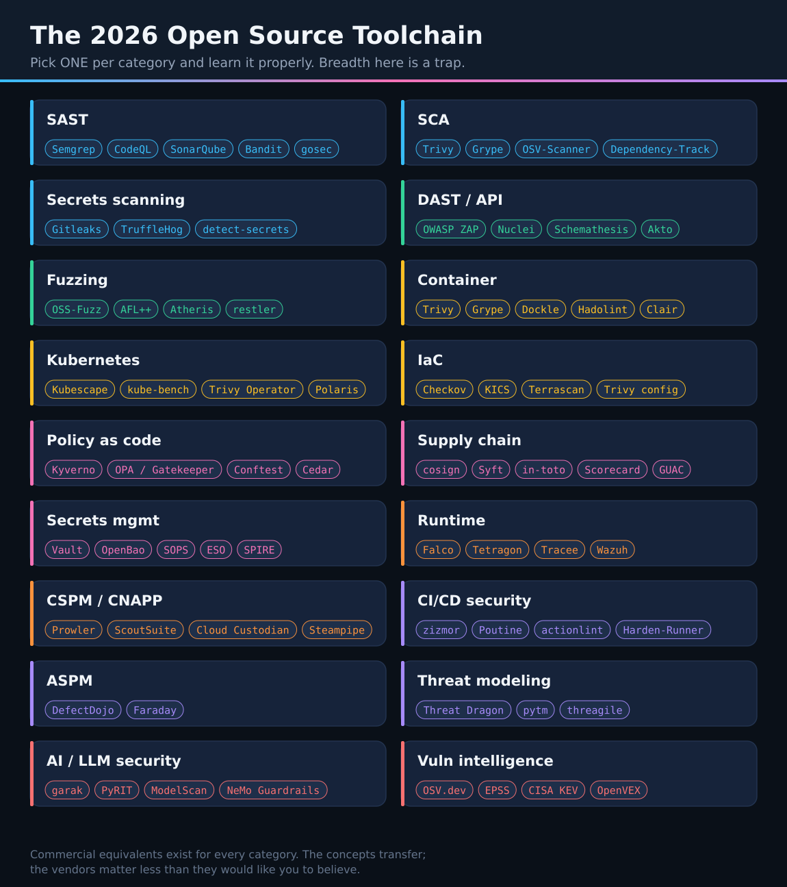

# The DevSecOps Toolchain

[](../assets/devsecops-toolchain.svg)

**Pick one per category and learn it properly.** Breadth here is a trap: knowing twelve scanners shallowly is less valuable than knowing one deeply enough to tune it, extend it, and explain its false positives.

Everything below is open source unless marked <sup>COMMERCIAL</sup>.

---

## How to choose

Before evaluating any tool, answer these five questions. They eliminate most of the field immediately.

1. **What decision will this tool's output drive?** If nobody will act on it, do not deploy it.
2. **Where does it run?** Pre-commit, PR, build, admission, and runtime have completely different latency budgets.
3. **What is its false positive rate on *your* code?** Trial it on a real repo. Vendor benchmarks are meaningless.
4. **Can you write custom rules?** Generic rules find generic bugs. Your bugs are specific.
5. **Does it output SARIF?** One aggregation point, one ticket per real problem. Tools that only render their own dashboard create work.

> A tool that produces 500 findings nobody triages is worse than no tool, because it trains your engineers to ignore security output.

---

## Secret scanning

*Run at pre-commit, on PRs, and over full history. The highest value-per-hour control in this document.*

| Tool | Notes |
|---|---|
| **[Gitleaks](https://github.com/gitleaks/gitleaks)** | Fast, good defaults, easy custom rules. The usual default choice. |
| **[TruffleHog](https://github.com/trufflesecurity/trufflehog)** | **Verifies** credentials against the live provider — dramatically fewer false positives |
| [detect-secrets](https://github.com/Yelp/detect-secrets) | Baseline-oriented; excellent for retrofitting onto a repo with existing findings |
| GitHub Secret Scanning + Push Protection | Free on public repos; blocks the push before the secret exists |
| GitGuardian <sup>COMMERCIAL</sup> | Strong verification, historical scanning, incident workflow |

**Start with:** Gitleaks at pre-commit + TruffleHog over full history + platform push protection.

> Finding the secret is step one. **Rotate first, then investigate, then clean history.** Rewriting history without rotating leaves the credential valid and the attacker in.

---

## SAST

*PR-time, diff-aware. If it takes 40 minutes, it will be disabled.*

| Tool | Notes |
|---|---|
| **[Semgrep](https://semgrep.dev/)** | Rules look like the code they match. Custom-rule authoring is genuinely easy — this is the differentiator. |
| **[CodeQL](https://codeql.github.com/)** | Deepest dataflow analysis available; steeper learning curve; free for public repos |
| [SonarQube](https://www.sonarsource.com/products/sonarqube/) | Quality + security together; well established in enterprises |
| [Bandit](https://github.com/PyCQA/bandit) · [gosec](https://github.com/securego/gosec) · [Brakeman](https://brakemanscanner.org/) | Language-specific, fast, good in pre-commit |
| Snyk Code / Checkmarx / Veracode <sup>COMMERCIAL</sup> | Broader language support, managed rules, enterprise reporting |

**Start with:** Semgrep, and write three rules for your own codebase's anti-patterns in the first week. That is where the value is — not in the registry rules.

---

## SCA (dependencies)

| Tool | Notes |
|---|---|
| **[Trivy](https://github.com/aquasecurity/trivy)** | One binary: dependencies, containers, IaC, secrets, licenses. Best starting point. |
| **[OSV-Scanner](https://github.com/google/osv-scanner)** | Backed by [OSV.dev](https://osv.dev/); precise version ranges, low noise |
| [Grype](https://github.com/anchore/grype) | Pairs naturally with Syft for SBOM-driven scanning |
| **[Dependency-Track](https://dependencytrack.org/)** | Continuously re-evaluates **stored SBOMs** against new advisories. This is how you answer "are we affected?" in minutes. |
| [OWASP Dependency-Check](https://owasp.org/www-project-dependency-check/) | Long-established; noisier CPE-based matching |
| Snyk / Mend / Endor Labs <sup>COMMERCIAL</sup> | Reachability analysis and automated fix PRs are the real differentiators |

**Start with:** Trivy in CI + Dependency-Track as the system of record.

---

## DAST & API testing

*Nightly against staging — too slow and too stateful for a PR.*

| Tool | Notes |
|---|---|
| **[OWASP ZAP](https://www.zaproxy.org/)** | The open-source standard; the Automation Framework makes it CI-friendly |
| **[Nuclei](https://github.com/projectdiscovery/nuclei)** | Template-based; superb for known-CVE and misconfiguration checks at scale |
| [Schemathesis](https://schemathesis.readthedocs.io/) | Property-based testing driven by your OpenAPI spec — catches what example-based tests miss |
| [Akto](https://github.com/akto-api-security/akto) | API discovery plus testing; finds the endpoints nobody documented |
| [Burp Suite Professional](https://portswigger.net/burp) <sup>COMMERCIAL</sup> | The manual testing standard; Enterprise edition for automation |

**Start with:** ZAP baseline scan nightly, then add Schemathesis if you have an OpenAPI spec.

---

## Container & image security

| Tool | Notes |
|---|---|
| **[Trivy](https://github.com/aquasecurity/trivy)** | Image vulnerabilities, misconfigurations, secrets, SBOM |
| [Grype](https://github.com/anchore/grype) + [Syft](https://github.com/anchore/syft) | Scan and SBOM as separate, composable tools |
| [Hadolint](https://github.com/hadolint/hadolint) | Dockerfile linting — catches problems before the image exists |
| [Dockle](https://github.com/goodwithtech/dockle) | CIS-aligned image configuration audit |
| [Distroless](https://github.com/GoogleContainerTools/distroless) · [Chainguard Images](https://images.chainguard.dev/) | Minimal base images. Usually removes more CVEs than any scanner will ever help you fix. |
| [Docker Bench](https://github.com/docker/docker-bench-security) | Audits the Docker host itself |

> The highest-leverage container security action is not a scanner. It is changing the base image.

---

## Kubernetes security

| Tool | Notes |
|---|---|
| **[Kubescape](https://github.com/kubescape/kubescape)** | CNCF; scans against NSA/CISA, CIS, and MITRE frameworks |
| **[kube-bench](https://github.com/aquasecurity/kube-bench)** | CIS Kubernetes Benchmark |
| [Trivy Operator](https://github.com/aquasecurity/trivy-operator) | Continuous in-cluster scanning, results as CRDs |
| [Polaris](https://github.com/FairwindsOps/polaris) · [kubeaudit](https://github.com/Shopify/kubeaudit) | Workload configuration best practices |
| [rbac-tool](https://github.com/alcideio/rbac-tool) · [KubiScan](https://github.com/cyberark/KubiScan) | RBAC analysis and privilege escalation paths |
| [kube-hunter](https://github.com/aquasecurity/kube-hunter) | Offensive perspective on your own cluster |

---

## Policy as code

| Tool | Notes |
|---|---|
| **[Kyverno](https://kyverno.io/)** | CNCF **Graduated** (Mar 2026). YAML policies — no new language. Validates, mutates, generates, and verifies image signatures. Best default for Kubernetes. |
| **[OPA / Gatekeeper](https://www.openpolicyagent.org/)** | General-purpose; Rego works far beyond Kubernetes (APIs, Terraform, CI) |
| [ValidatingAdmissionPolicy](https://kubernetes.io/docs/reference/access-authn-authz/validating-admission-policy/) | Kubernetes-native, CEL-based, no external webhook to operate |
| [Conftest](https://www.conftest.dev/) | Run Rego against any structured config in CI |
| [Cedar](https://www.cedarpolicy.com/) | AWS's authorization policy language; verification-friendly |

**Rule of thumb:** Kyverno for Kubernetes, OPA/Conftest for everything else.

---

## IaC security

| Tool | Notes |
|---|---|
| **[Checkov](https://www.checkov.io/)** | Broadest rule coverage; Terraform, CloudFormation, K8s, ARM, Helm, GitHub Actions |
| [Trivy config](https://github.com/aquasecurity/trivy) | Fast, one binary alongside your other Trivy usage (absorbed tfsec) |
| [KICS](https://kics.io/) | Checkmarx; wide platform support |
| [Terrascan](https://github.com/tenable/terrascan) | OPA-based, so policies are portable |

> **Scan the plan, not just the source.** `terraform show -json plan.out` reveals what variables and modules actually resolve to. Source-only scanning misses a large share of real misconfigurations.

---

## Secrets management

| Tool | Notes |
|---|---|
| **[HashiCorp Vault](https://www.vaultproject.io/)** | The reference implementation; dynamic secrets are the feature that matters |
| **[OpenBao](https://openbao.org/)** | Linux Foundation fork of Vault; fully open source |
| [External Secrets Operator](https://external-secrets.io/) | Syncs from any external manager into Kubernetes — the usual glue |
| [SOPS](https://github.com/getsops/sops) + [age](https://github.com/FiloSottile/age) | Encrypted secrets in Git, GitOps-friendly |
| [Sealed Secrets](https://github.com/bitnami-labs/sealed-secrets) | Simpler GitOps model, cluster-bound encryption |
| **[SPIFFE/SPIRE](https://spiffe.io/)** | Cryptographic workload identity — the end state, where there is no secret to manage |
| Cloud-native: AWS Secrets Manager, Azure Key Vault, GCP Secret Manager | Lowest operational burden if you are single-cloud |

**The goal is not storing secrets well. It is not having long-lived secrets.** OIDC federation for CI is usually the highest-value first project.

---

## Supply chain

| Tool | Notes |
|---|---|
| **[Sigstore / cosign](https://www.sigstore.dev/)** | Keyless signing via OIDC. Removes the key management problem that killed every earlier signing initiative. |
| **[Syft](https://github.com/anchore/syft)** | SBOM generation (CycloneDX, SPDX) |
| [cdxgen](https://github.com/CycloneDX/cdxgen) | Deep, language-aware CycloneDX generation |
| **[in-toto](https://in-toto.io/)** | CNCF **Graduated** (Apr 2025); attestations across supply chain steps |
| [SLSA tooling](https://slsa.dev/) | Provenance generation and verification |
| **[OpenSSF Scorecard](https://github.com/ossf/scorecard)** | Automated health checks on your dependencies |
| [GUAC](https://guac.sh/) | Graph queries across SBOMs, attestations, and vulnerabilities |
| [vexctl](https://github.com/openvex/vexctl) | Produce OpenVEX statements to stop re-triaging not-affected CVEs |
| [Renovate](https://docs.renovatebot.com/) | Dependency updates with SHA pinning and cooldown windows |

---

## CI/CD security

| Tool | Notes |
|---|---|
| **[zizmor](https://github.com/zizmorcore/zizmor)** | Static analysis for GitHub Actions: template injection, excessive permissions, artifact poisoning |
| **[Poutine](https://github.com/boostsecurityio/poutine)** | Multi-platform pipeline analysis (GitHub, GitLab, Azure DevOps) |
| [actionlint](https://github.com/rhysd/actionlint) | Workflow syntax and expression linting |
| [Harden-Runner](https://github.com/step-security/harden-runner) | Runner egress monitoring and blocking — exfiltration needs a network path |
| [pinact](https://github.com/suzuki-shunsuke/pinact) | Automatically pins actions to full commit SHAs |

**If you adopt one thing from this section: pin every action to a full commit SHA.** That single control would have prevented `tj-actions`.

---

## Runtime security

| Tool | Notes |
|---|---|
| **[Falco](https://falco.org/)** | CNCF **Graduated**; the runtime detection standard. Custom rule authoring is the skill worth having. |
| **[Tetragon](https://tetragon.io/)** | eBPF observability **and enforcement**, from the Cilium project |
| [Tracee](https://github.com/aquasecurity/tracee) | eBPF runtime detection and forensics |
| [Wazuh](https://wazuh.com/) | Open-source XDR/SIEM: HIDS, FIM, log analysis, compliance |
| [Sigma](https://github.com/SigmaHQ/sigma) | Vendor-neutral detection rule format |
| [Atomic Red Team](https://github.com/redcanaryco/atomic-red-team) | Test your detections — an untested detection is a hypothesis |

---

## Cloud security posture

| Tool | Notes |
|---|---|
| **[Prowler](https://github.com/prowler-cloud/prowler)** | AWS, Azure, GCP, Kubernetes; hundreds of checks mapped to frameworks |
| [ScoutSuite](https://github.com/nccgroup/ScoutSuite) | Multi-cloud auditing with an excellent HTML report |
| [Cloud Custodian](https://cloudcustodian.io/) | Policy **and** automated remediation — detection plus response |
| [Steampipe](https://steampipe.io/) / Powerpipe | Query cloud configuration as SQL. Surprisingly powerful for ad-hoc investigation. |
| [PMapper](https://github.com/nccgroup/PMapper) | Maps IAM privilege escalation paths |
| [Pacu](https://github.com/RhinoSecurityLabs/pacu) | AWS exploitation framework — the attacker's view of your account |
| Wiz / Orca / Prisma Cloud <sup>COMMERCIAL</sup> | Agentless CNAPP; strong correlation and prioritisation |

---

## ASPM (aggregation)

*Once you run more than three scanners, correlation matters more than another scanner.*

| Tool | Notes |
|---|---|
| **[DefectDojo](https://github.com/DefectDojo/django-DefectDojo)** | Mature open-source vulnerability management; ingests almost every scanner format |
| [Faraday](https://github.com/infobyte/faraday) | Collaborative security data aggregation |
| Cycode / Apiiro / Ox / Legit <sup>COMMERCIAL</sup> | Code-to-cloud correlation, ownership mapping, risk-based prioritisation |

---

## Threat modeling

| Tool | Notes |
|---|---|
| [OWASP Threat Dragon](https://owasp.org/www-project-threat-dragon/) | Free diagramming with STRIDE prompts |
| [pytm](https://github.com/OWASP/pytm) | Threat models as Python — versioned, diffable, reviewed in PRs |
| [threagile](https://threagile.io/) | Threat models as YAML, with generated diagrams and risk reports |
| IriusRisk / SD Elements <sup>COMMERCIAL</sup> | Enterprise threat modeling with requirement generation |

---

## AI / LLM security

| Tool | Notes |
|---|---|
| [garak](https://github.com/NVIDIA/garak) | LLM vulnerability scanner — prompt injection, jailbreaks, data leakage |
| [PyRIT](https://github.com/Azure/PyRIT) | Microsoft's AI red-teaming toolkit |
| [ModelScan](https://github.com/protectai/modelscan) · [picklescan](https://github.com/mmaitre314/picklescan) | Scan model artifacts for malicious serialised code |
| [NeMo Guardrails](https://github.com/NVIDIA/NeMo-Guardrails) · [Guardrails AI](https://github.com/guardrails-ai/guardrails) | Runtime constraints on model behaviour |

> Guardrails reduce risk; they do not eliminate prompt injection. Design so that a successful injection cannot do damage: least-privilege tools, human approval for irreversible actions, model output treated as untrusted input.

---

## A realistic starting stack

For a team with no security tooling today, in adoption order:

```
1. Gitleaks           pre-commit + CI          secrets
2. pinact + zizmor    CI                       pipeline integrity
3. Trivy              CI + registry            dependencies, containers, IaC
4. Semgrep            PR, diff-aware           SAST with 3 custom rules
5. OIDC federation    CI                       delete every static cloud key
6. Syft + cosign      build                    SBOM + signing
7. Kyverno            cluster, Audit first     admission policy + verification
8. Prowler            scheduled                cloud posture
9. DefectDojo         continuous               aggregate all of the above
10. Falco             cluster                  runtime detection
```

That is roughly one quarter of work for a small team, and covers most of what actually goes wrong.

**Do not deploy step 10 before step 1.** Runtime detection with secrets sitting in Git is optimising the wrong end of the problem.
